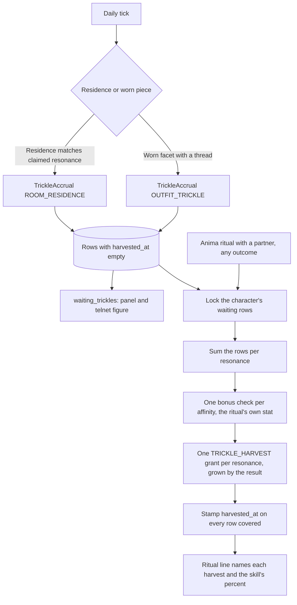
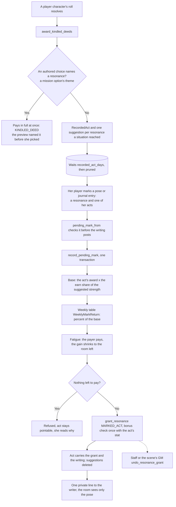
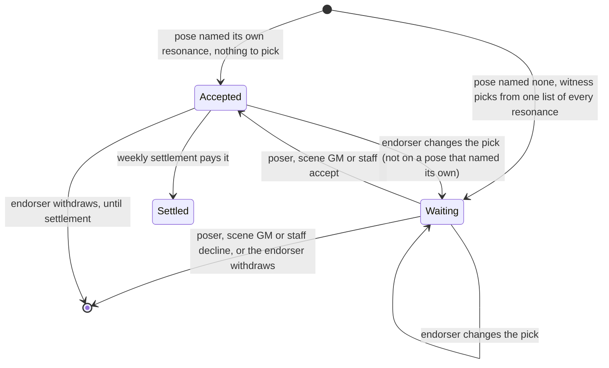

# Resonance Pivot — Spec C: Resonance Gain Surfaces

**Status:** Design
**Date:** 2026-04-22
**Depends on:** Resonance Pivot Spec A (DONE), Scope 6 Soulfray Recovery & Decay
(DONE — for scheduler pattern)
**Blocks:** None — can be developed standalone.
**Related:** Spec A §3.1 (earn interface), §8.2 (Spec C handoff), Scope 6 daily
tick infrastructure.

**Implementation note (as shipped — updated #2036):** the room-aura layer below
(§2.5–2.6, `RoomAuraProfile`/`RoomResonance`) was never built as modeled. Room
resonance tags are `LocationValueModifier` rows (`key_type=RESONANCE`,
`source=ROOM_RESONANCE_TAG_SOURCE`) written by `tag_room_resonance`/
`untag_room_resonance` (`world/magic/services/gain.py`) — no separate room-aura
model exists; see `world/magic/CLAUDE.md` and `docs/systems/INDEX.md`. The
residence-declaration API in §4.1/§4.2 (a raw `PATCH .../character-sheets/<id>/`
writing `current_residence_id`) was never built either — the shipped seam is
action-based: `world.locations.services.set_primary_home` (via
`SetPrimaryHomeAction` — telnet `room/home` and `home/set`, and the web "Set as
Home" button) writes `CharacterSheet.current_residence` alongside Evennia
`home`, and additionally accepts org-derived owner/tenant standing (not only a
direct `LocationTenancy` row) by minting a personal tenancy first (#2036). Room
aura tagging itself reached telnet as `room/aura <resonance>` / `room/aura
clear <resonance>` (Actions `tag_room_resonance`/`untag_room_resonance`, gated
by the owner-or-tenant `IsRoomTenantPrerequisite`) and the web
`RoomAuraPicker` — no REST endpoint for either. The rest of this spec (models
§2.1–2.4, services §3.0–3.2/3.4–3.5, API §4.3–4.4, rules §5.1/5.2/5.4/5.5)
matches what shipped.

**Implementation note (changed by #5308):** the two daily trickles (§5.3 residence, §5.4 outfit) no
longer call `grant_resonance`. They write `TrickleAccrual` rows that wait until an anima ritual
harvests them, and every earned gain now meets a bonus resonance check. §13 describes both, with the
trickle flow diagram. §5.3 and §5.4 below carry the corrected rules.

**Implementation note (changed by #5327):** a character no longer earns resonance by acting on a
situation, and claiming a set-aside share is gone. An authored choice pays at once, and every other gain
from play is a pose or journal entry that names a resonance and points at an act her character took (a
mark). A pose endorsement on a pose that named no resonance takes any resonance and waits for the poser.
§14 describes both, with diagrams; §2.2, §3.1, §5.2, §7.2 and §13.3 below carry the corrected rules.

---

## 1. Context & Design Intent

### 1.1 What Spec A left us

Spec A built the full Thread currency economy: `CharacterResonance.balance`
(spendable) + `lifetime_earned` (monotonic audit), the `grant_resonance`
service function, and the Thread / Imbuing / Pull machinery that currency
flows into. But Spec A explicitly deferred the *gain surfaces* — the sites
that actually call `grant_resonance` — to this spec. Today there are zero
such callers in the codebase. The whole Thread economy is mechanically
inert: no character can earn spendable resonance from gameplay, so Imbuing
and pulls are unreachable by normal play.

`grant_resonance` already accepts `source: str` and `source_ref: int | None`
kwargs that it currently ignores. Spec A flagged them as "reserved for
Phase 12 audit hook" — that hook is this spec.

### 1.2 What this spec builds

**Four gain surfaces, all routing through `grant_resonance`:**

1. **Scene-entry endorsement** — immediate, flat-per-grant, once per
   `(endorser, endorsee, scene)` pair. Peers already present in the scene
   endorse a character's entry pose.
2. **Pose endorsement** — deferred, weekly "divide-by-use" settlement.
   Peers tag in-scene interactions throughout the week; at weekly tick
   each endorser's fixed pot divides across their endorsements
   (`ceil(pot / N)`).
3. **Room residence trickle**: daily passive, one waiting `TrickleAccrual`
   row per claimed resonance that matches the character's current residence's
   aura tags (since #5308 an anima ritual turns the pile into resonance).
4. **Outfit trickle**: daily passive, one waiting `TrickleAccrual` row per
   worn facet the wearer holds a thread on (built since Spec D; harvested like
   the residence trickle).

**Mechanical auto-gains are cut from scope.** Earlier brainstorming
considered awarding resonance on technique use, ritual completion, or
relationship-track advances. All removed — the design intent is that
resonance gain is the mechanical reward for *RP that portrays and is
perceived as the character you've claimed to be*, not the reward for
pressing magic buttons.

### 1.3 Design philosophy: aura farming, made literal

> *"Making an impressive entrance should actually grant magical power.
> Wearing a costume that reinforces your identity should passively generate
> resonance. The evil sorceress who resides in a spider-lair and wears
> webs gains more resonance than Bob the Bland who blends in with the
> normies. The world's lore literally requires characters to walk the
> walk of their chosen role."*

Resonance is the reinforcement mechanic that justifies doubling down on
narrative tropes. The magic system rewards commitment to identity. Players
who refuse to commit to a vibe get no mechanical benefit from the magic
system — that's the design intent, not a balancing problem.

Peer endorsement of roleplay is the **main** source. Room residence is a
significant passive bump to reward *decorating thematically*. Outfit is a
deliberate forward hook for the Items system. All other surfaces are out
of scope.

### 1.4 Pre-alpha balance posture

We have no players. All tuning values in this spec are placeholders,
staff-editable via admin, intended to be adjusted during playtest. The
design does *not* lock in any specific magnitudes; it locks in the
*shape* of the economy and the *mechanisms* by which values are applied,
so that tuning is a config change, not a code change.

Target active-vs-passive ratio: an active RPer in 3+ scenes/week with
peer engagement and a themed lair should out-earn a fashion-maxed
passive-only hermit by roughly 2–3×. Values tuned to hit that target
during playtest.

---

## 2. Models

All new models live in `world/magic` unless otherwise noted. All use
`SharedMemoryModel`. All concrete models use the existing patterns for
timestamps (`auto_now_add`) and audit FKs.

### 2.1 `ResonanceGainConfig` (singleton tuning surface)

Staff-editable singleton. All gain magnitudes live here. Exposed via
Django admin; no code changes required to tune.

```python
class ResonanceGainConfig(SharedMemoryModel):
    """Singleton tuning surface for Resonance gain. One row per environment."""

    weekly_pot_per_character = PositiveIntegerField(default=20)
    scene_entry_grant = PositiveIntegerField(default=4)
    residence_daily_trickle_per_resonance = PositiveIntegerField(default=1)
    outfit_daily_trickle_per_item_resonance = PositiveIntegerField(default=1)
    same_pair_daily_cap = PositiveIntegerField(default=0)  # 0 = off
    settlement_day_of_week = IntegerField(default=0)  # Monday = 0 (ISO)

    updated_at = DateTimeField(auto_now=True)
    updated_by = ForeignKey(AccountDB, null=True, on_delete=SET_NULL)
```

**Singleton enforcement:** singleton-by-convention, enforced at the service
layer via `get_resonance_gain_config()` (get-or-create on a reserved pk=1).
No DB-level constraint — matches the lightweight singleton pattern used
elsewhere in the codebase. `get_resonance_gain_config()` lazily creates
the row on first read. This is the only resonance-gain config model in
the system.

### 2.2 `PoseEndorsement` (weekly deferred)

```python
class PoseEndorsement(SharedMemoryModel):
    endorser_sheet = ForeignKey(CharacterSheet, on_delete=CASCADE,
                                related_name="pose_endorsements_given")
    endorsee_sheet = ForeignKey(CharacterSheet, on_delete=CASCADE,
                                related_name="pose_endorsements_received")
    interaction = ForeignKey(Interaction, on_delete=CASCADE,
                             related_name="endorsements")
    resonance = ForeignKey(Resonance, on_delete=PROTECT)
    persona_snapshot = ForeignKey(Persona, on_delete=SET_NULL, null=True,
                                  help_text="Endorsee's persona at endorsement time — "
                                            "captures masquerade for audit.")
    created_at = DateTimeField(auto_now_add=True, db_index=True)
    settled_at = DateTimeField(null=True, blank=True, db_index=True)
    granted_amount = PositiveIntegerField(null=True, blank=True,
                                           help_text="Set at weekly settlement.")
    awaiting_acceptance = BooleanField(default=False, db_default=False,
                                       help_text="True while a witness's proposed resonance "
                                                 "waits for the poser or a GM to accept it. "
                                                 "Settlement skips these rows. (#5327)")

    class Meta:
        constraints = [
            UniqueConstraint(fields=["endorser_sheet", "interaction"],
                             name="unique_pose_endorsement_per_endorser_per_interaction"),
        ]
        indexes = [
            Index(fields=["endorser_sheet", "settled_at"],
                  name="pose_endorsement_unsettled_idx"),
        ]
```

Validation at creation (in `create_pose_endorsement` service):
- `endorser_sheet != endorsee_sheet` derived from `interaction.persona.character_sheet`.
- `account_for_sheet(endorser_sheet) != account_for_sheet(endorsee_sheet)` — alt guard.
- `interaction.mode != WHISPER` — whispers don't count (private, not witnessed).
- `interaction.visibility != VERY_PRIVATE` — private visibility also excluded.
- Endorser was a scene participant of `interaction.scene` (historical
  `SceneParticipation` row) OR is in `interaction.cached_receivers` for
  organic grid RP.
- The pose's author reached for a resonance (#5308): that resonance is paid and the row is
  confirmed. Otherwise `resonance` is any resonance at all (#5327), in the endorsee's aura or not, and the
  row is saved with `awaiting_acceptance` set until the poser accepts it (§14.3). The #1138 rule that the
  endorsee must already have the resonance is gone.
- The pose's mark has not already paid: a pose that carried a paid mark (§14.1) cannot also be endorsed.

### 2.3 `SceneEntryEndorsement` (immediate, flat)

```python
class SceneEntryEndorsement(SharedMemoryModel):
    endorser_sheet = ForeignKey(CharacterSheet, on_delete=CASCADE,
                                related_name="scene_entry_endorsements_given")
    endorsee_sheet = ForeignKey(CharacterSheet, on_delete=CASCADE,
                                related_name="scene_entry_endorsements_received")
    scene = ForeignKey(Scene, on_delete=CASCADE,
                       related_name="entry_endorsements")
    entry_interaction = ForeignKey(Interaction, on_delete=SET_NULL,
                                    null=True, blank=True,
                                    help_text="The ENTRY pose being endorsed; nullable "
                                              "for resilience to interaction cleanup.")
    resonance = ForeignKey(Resonance, on_delete=PROTECT)
    persona_snapshot = ForeignKey(Persona, on_delete=SET_NULL, null=True)
    granted_amount = PositiveIntegerField(help_text="Captured from config at creation.")
    created_at = DateTimeField(auto_now_add=True)

    class Meta:
        constraints = [
            UniqueConstraint(fields=["endorser_sheet", "endorsee_sheet", "scene"],
                             name="unique_scene_entry_endorsement_per_pair_per_scene"),
        ]
```

Validation at creation (in `create_scene_entry_endorsement` service):
- Endorser has a historical `SceneParticipation` row on the scene (no
  `joined_at` comparison — "hearing about a banger entrance secondhand"
  is legitimate, and we don't want to incentivize arriving late).
- `endorsee_sheet` has an `Interaction` with `pose_kind=ENTRY`,
  `scene=scene`, persona FK resolving to `endorsee_sheet`.
- Alt guard (account level).
- Resonance is in endorsee's claimed list.
- Pair+scene unique.

On success, the row is created AND `grant_resonance` fires synchronously
in the same transaction.

### 2.4 `ResonanceGrant` (universal audit ledger)

Every `grant_resonance` call writes one row here. This is the source of
truth for "how did this character earn this resonance" — the audit feed
that populates the player-facing ledger and any future leaderboard.

**Discriminator + typed-FK pattern**, matching Spec A's `Thread`,
`ThreadWeavingUnlock`, and other polymorphic-join models in this
codebase. No raw-int source references; no generic foreign keys.

```python
class GainSource(TextChoices):
    POSE_ENDORSEMENT = "POSE_ENDORSEMENT", "Pose endorsement"
    SCENE_ENTRY = "SCENE_ENTRY", "Scene entry endorsement"
    ROOM_RESIDENCE = "ROOM_RESIDENCE", "Room residence trickle"
    OUTFIT_ITEM = "OUTFIT_ITEM", "Outfit item trickle"
    STAFF_GRANT = "STAFF_GRANT", "Staff grant"


class ResonanceGrant(SharedMemoryModel):
    character_sheet = ForeignKey(CharacterSheet, on_delete=CASCADE,
                                  related_name="resonance_grants")
    resonance = ForeignKey(Resonance, on_delete=PROTECT)
    amount = PositiveIntegerField()
    source = CharField(max_length=24, choices=GainSource.choices,
                       help_text="Discriminator. Identifies which source_* FK is "
                                 "populated.")
    granted_at = DateTimeField(auto_now_add=True, db_index=True)

    # Typed source FKs — exactly one populated per row, matching `source`.
    source_pose_endorsement = ForeignKey(
        "magic.PoseEndorsement", null=True, blank=True,
        on_delete=PROTECT, related_name="resonance_grants",
    )
    source_scene_entry_endorsement = ForeignKey(
        "magic.SceneEntryEndorsement", null=True, blank=True,
        on_delete=PROTECT, related_name="resonance_grants",
    )
    source_room_aura_profile = ForeignKey(
        "magic.RoomAuraProfile", null=True, blank=True,
        on_delete=PROTECT, related_name="resonance_grants",
    )
    # NOTE: `source_item_instance` is intentionally absent at launch — the
    # Items app doesn't exist yet, so the FK can't be declared. The field +
    # its CheckConstraint are added by the Items system's first migration
    # when that app ships. Since the outfit trickle is a no-op stub at
    # launch, no `OUTFIT_ITEM` rows are ever written in the meantime.
    # Staff grants: the acting staff account; SET_NULL so account retirement
    # doesn't cascade into the audit log.
    source_staff_account = ForeignKey(
        "accounts.AccountDB", null=True, blank=True,
        on_delete=SET_NULL, related_name="resonance_grants_issued",
    )

    class Meta:
        indexes = [
            Index(fields=["character_sheet", "granted_at"],
                  name="resonance_grant_sheet_time_idx"),
            Index(fields=["character_sheet", "source", "granted_at"],
                  name="resonance_grant_sheet_source_idx"),
        ]
        constraints = [
            # Per-discriminator CheckConstraints — matches Spec A's Thread
            # model (`thread_pose_endorsement_shape`, etc.). Each constraint
            # enforces "matching source FK is NOT NULL and all other source
            # FKs ARE NULL" for one discriminator value.
            CheckConstraint(
                name="resonance_grant_pose_endorsement_shape",
                check=(
                    Q(source="POSE_ENDORSEMENT")
                    & Q(source_pose_endorsement__isnull=False)
                    & Q(source_scene_entry_endorsement__isnull=True)
                    & Q(source_room_aura_profile__isnull=True)
                    & Q(source_item_instance__isnull=True)
                    & Q(source_staff_account__isnull=True)
                ) | ~Q(source="POSE_ENDORSEMENT"),
            ),
            CheckConstraint(
                name="resonance_grant_scene_entry_shape",
                check=(
                    Q(source="SCENE_ENTRY")
                    & Q(source_pose_endorsement__isnull=True)
                    & Q(source_scene_entry_endorsement__isnull=False)
                    & Q(source_room_aura_profile__isnull=True)
                    & Q(source_item_instance__isnull=True)
                    & Q(source_staff_account__isnull=True)
                ) | ~Q(source="SCENE_ENTRY"),
            ),
            CheckConstraint(
                name="resonance_grant_residence_shape",
                check=(
                    Q(source="ROOM_RESIDENCE")
                    & Q(source_pose_endorsement__isnull=True)
                    & Q(source_scene_entry_endorsement__isnull=True)
                    & Q(source_room_aura_profile__isnull=False)
                    & Q(source_item_instance__isnull=True)
                    & Q(source_staff_account__isnull=True)
                ) | ~Q(source="ROOM_RESIDENCE"),
            ),
            # NOTE: the OUTFIT_ITEM shape constraint is absent at launch —
            # it references `source_item_instance`, which doesn't exist
            # until the Items app ships. Added alongside the FK by the
            # Items system's first migration. Form at that time:
            #
            #   CheckConstraint(
            #       name="resonance_grant_outfit_shape",
            #       check=(
            #           Q(source="OUTFIT_ITEM")
            #           & Q(source_pose_endorsement__isnull=True)
            #           & Q(source_scene_entry_endorsement__isnull=True)
            #           & Q(source_room_aura_profile__isnull=True)
            #           & Q(source_item_instance__isnull=False)
            #           & Q(source_staff_account__isnull=True)
            #       ) | ~Q(source="OUTFIT_ITEM"),
            #   ),
            CheckConstraint(
                name="resonance_grant_staff_shape",
                check=(
                    Q(source="STAFF_GRANT")
                    & Q(source_pose_endorsement__isnull=True)
                    & Q(source_scene_entry_endorsement__isnull=True)
                    & Q(source_room_aura_profile__isnull=True)
                    & Q(source_item_instance__isnull=True)
                    # Staff account is typically populated but nullable
                    # (SET_NULL on retirement) so we don't require NOT NULL.
                ) | ~Q(source="STAFF_GRANT"),
            ),
        ]
```

**Model-level `clean()`** additionally validates shape pre-save for
friendly errors during admin/test creation (matches Thread's pattern).

**Outfit FK deferral — explicit.** Django migrations cannot declare a
FK to a model in an app that doesn't exist yet. Therefore at launch:

- The `source_item_instance` field is **not in the model** — not present,
  not commented as a placeholder, simply absent from Spec C's migration.
- The `resonance_grant_outfit_shape` CheckConstraint is also **not in the
  model** — omitted alongside the FK.
- The `OUTFIT_ITEM` value on `GainSource` **is declared** (reserved enum
  slot), but no code path produces a row with that source value.
- The outfit trickle helper (§5.4) returns an empty iterable, so the
  tick loop never attempts an outfit grant.

When the Items app ships, its first migration adds (in one pass):
- The `source_item_instance` FK to `ResonanceGrant`.
- The `resonance_grant_outfit_shape` CheckConstraint.
- The `get_outfit_resonance_contributions` implementation + `ItemTemplate`
  or wearable-subtype `resonances` M2M.

This is a clean forward-compatible deferral — no forward-referenced FKs,
no schema instability, and the discriminator pattern is preserved intact
once Items lands.

**Invariant (modulo reversals — see §8.4 / §11.4):**

At launch, with no retraction model yet resolved, the invariant is
`sum(ResonanceGrant.amount WHERE character_sheet=X AND resonance=Y) ==
CharacterResonance.lifetime_earned WHERE character_sheet=X AND resonance=Y`.
`grant_resonance` writes both transactionally.

Once retraction lands (§11.4 chooses between option (a) separate
`ResonanceGrantReversal` model vs. option (b) signed `IntegerField`),
the invariant restates to either `sum(grants) - sum(reversals) ==
lifetime_earned` (option a) or `sum(amount)` with signed ints (option b).
Implementers: do NOT codify the current simple-sum invariant into a test
that will break when reversals are added. Reference this section's
variable form.

No drift-detection infrastructure — a staff reconciliation query handles
the rare case of drift.

### 2.5 `RoomAuraProfile` (room's magical character)

Represents the room's own magical nature — resonance tags, future ambient
effects, future place-of-power amplification, future decoration-as-
magical-furniture. **Independent of residence.** Holy sites, abyssal
grottos, battle venues, and personal lairs all host a `RoomAuraProfile`
if they have magical character. Non-magical rooms simply have no aura
profile (the OneToOne reverse lookup returns None).

```python
class RoomAuraProfile(SharedMemoryModel):
    room_profile = OneToOneField(RoomProfile, primary_key=True,
                                  on_delete=CASCADE,
                                  related_name="room_aura_profile")
    # Future: place_of_power flag, ambient_effect fields,
    # decoration summary, combat bonus data.
```

### 2.6 `RoomResonance` (aura-profile ↔ resonance M2M through)

```python
class RoomResonance(SharedMemoryModel):
    room_aura_profile = ForeignKey(RoomAuraProfile, on_delete=CASCADE,
                                    related_name="room_resonances")
    resonance = ForeignKey(Resonance, on_delete=PROTECT)
    set_by = ForeignKey(AccountDB, on_delete=SET_NULL, null=True,
                        help_text="Staff/player who tagged this resonance.")
    set_at = DateTimeField(auto_now_add=True)

    class Meta:
        constraints = [
            UniqueConstraint(fields=["room_aura_profile", "resonance"],
                             name="unique_room_resonance_per_profile"),
        ]
```

### 2.7 Changes to existing models

**`CharacterSheet.current_residence`** — new FK:

```python
current_residence = ForeignKey(
    "evennia_extensions.RoomProfile",
    null=True, blank=True,
    on_delete=PROTECT,
    related_name="residents",
    help_text="The RoomProfile the character has declared as their residence. "
              "Residence is a neutral narrative declaration; mechanical trickle "
              "only fires if the residence also has a RoomAuraProfile with "
              "resonance tags matching the character's claimed resonances.",
)
```

**Why on CharacterSheet directly and not a dedicated `CharacterResidence`
extension model?** `current_residence` is a single nullable FK — no
per-row data hangs off it today (set_at / set_by audit lives on a future
change-log if needed, not on the residence itself). A OneToOne extension
model would be one-row-per-sheet with a single FK column, effectively a
table with no payload. The residence is also a property of "this
character" — natural to store alongside other character state. If future
residence-specific fields appear (move cooldowns, historical residence
tracking, multi-residence ownership), extraction to a
`CharacterResidence` model is a mechanical refactor. YAGNI applies.

**`Interaction.pose_kind`** — new TextChoices field:

```python
class PoseKind(TextChoices):
    STANDARD = "standard", "Standard"
    ENTRY = "entry", "Entry"
    DEPARTURE = "departure", "Departure"  # reserved for future

pose_kind = CharField(max_length=16, choices=PoseKind.choices,
                      default=PoseKind.STANDARD, db_index=True)
```

Spec C only reads `ENTRY`. `DEPARTURE` is reserved for a future departure-
pose mechanic. Setting `pose_kind=ENTRY` is the job of a future `+enter`
command (or API surface); Spec C does not implement that command.

**Partitioned-table note:** `Interaction` is partitioned. Adding
`pose_kind` is an additive column change — `mode`, `vote_count`, and
`visibility` already coexist on it. The partition SQL needs updating to
match the migration. Flagged for the implementation plan.

---

## 3. Services

All services in `world/magic/services/` (new submodule
`world/magic/services/gain.py` to keep the file focused).

### 3.0 `grant_resonance` signature update (Spec A carry-over)

Spec A shipped `grant_resonance` with `source: str` and `source_ref: int | None`
kwargs flagged as "reserved for Phase 12 audit hook" (i.e., this spec).
Spec C replaces them with the discriminator + typed-FK shape:

```python
def grant_resonance(
    character_sheet: CharacterSheet,
    resonance: Resonance,
    amount: int,
    *,  # kwargs-only from here
    source: GainSource,
    pose_endorsement: PoseEndorsement | None = None,
    scene_entry_endorsement: SceneEntryEndorsement | None = None,
    room_aura_profile: RoomAuraProfile | None = None,
    # item_instance kwarg NOT declared at launch — Items app doesn't exist.
    # Added by the Items system's first migration alongside the FK.
    staff_account: AccountDB | None = None,
) -> CharacterResonance:
    """Atomically grant resonance AND write the ResonanceGrant ledger row.

    Validates:
      - amount > 0
      - exactly one typed source kwarg is populated, matching `source`
        (except STAFF_GRANT, where staff_account is optional — retirement
        can null it)

    Persists the CharacterResonance update (balance + lifetime_earned) and
    the ResonanceGrant row in one transaction.
    """
```

**Migration path for existing callers.** Only test files currently call
`grant_resonance` (`src/world/magic/tests/test_resonance_services.py`,
`src/world/magic/tests/test_ritual_dispatch.py` — all use
`source="test"` ad-hoc strings). Those tests update alongside the
signature change. No production call sites exist today.

### 3.1 Endorsement creation

```python
def create_pose_endorsement(
    endorser_sheet: CharacterSheet,
    interaction: Interaction,
    resonance: Resonance,
) -> PoseEndorsement:
    """Validate and persist a pose endorsement.

    Does NOT fire grant_resonance — settlement happens weekly.

    A pose that named its own resonance is endorsed for it and confirmed. On a pose that
    named none, `resonance` may be any resonance and the row is saved awaiting the poser's
    acceptance (#5327); the weekly settlement skips it until she answers.

    Raises:
        EndorsementValidationError: precondition failure (alt guard, whisper, duplicate,
            non-participant, a pose whose mark already paid, no resonance chosen).
    """


def create_scene_entry_endorsement(
    endorser_sheet: CharacterSheet,
    endorsee_sheet: CharacterSheet,
    scene: Scene,
    resonance: Resonance,
) -> SceneEntryEndorsement:
    """Validate, persist, and grant the flat scene-entry reward.

    Atomic: writes the SceneEntryEndorsement row and fires grant_resonance
    (which writes the ResonanceGrant ledger row) in one transaction.

    Raises:
        ValidationError: precondition failure.
    """
```

### 3.2 Weekly settlement

```python
def settle_weekly_pot(endorser_sheet: CharacterSheet) -> SettlementResult:
    """Settle all unsettled PoseEndorsement rows for one endorser.

    For each endorser with unsettled endorsements:
      1. Sum N = count of unsettled endorsements for that endorser.
      2. share = ceil(config.weekly_pot_per_character / N)
      3. For each unsettled endorsement:
         - Call grant_resonance(endorsee_sheet, resonance, share,
                                source=POSE_ENDORSEMENT,
                                source_ref=<PoseEndorsement.pk>)
         - Set granted_amount = share, settled_at = now()
      4. All under one atomic transaction — partial settlement is impossible.

    Idempotent: re-running with no unsettled rows is a no-op.

    Returns:
        SettlementResult(endorser_sheet, endorsements_settled, total_granted).
    """
```

### 3.3 Residence management

```python
def set_residence(
    sheet: CharacterSheet,
    room_profile: RoomProfile | None,
) -> None:
    """Set or clear a character's current residence.

    Passing None clears the residence (character has no current lair).
    O(1) — updates the FK and invalidates any cached handler state.
    """


def tag_room_resonance(
    room_profile: RoomProfile,
    resonance: Resonance,
    set_by: AccountDB | None = None,
) -> RoomResonance:
    """Tag a room with a resonance. Lazy-creates RoomAuraProfile if missing.

    Idempotent: if the tag already exists, returns the existing row unchanged.
    """


def untag_room_resonance(
    room_profile: RoomProfile,
    resonance: Resonance,
) -> None:
    """Remove a resonance tag from a room. No-op if the tag doesn't exist."""


def get_residence_resonances(sheet: CharacterSheet) -> set[Resonance]:
    """Return the set of resonances granting trickle for this character.

    Computes: (sheet.current_residence → RoomAuraProfile → resonance tags)
              ∩ (sheet.character_resonances — claimed set).
    Returns empty set if sheet has no residence, residence has no aura
    profile, or no tags match claimed resonances.
    """
```

### 3.4 Daily + weekly ticks

```python
def resonance_daily_tick() -> ResonanceDailyTickSummary:
    """Master daily tick. Runs residence + outfit trickle.

    Registered in ``src/world/game_clock/tasks.py`` alongside
    ``anima_regen_tick`` and ``decay_all_conditions_tick`` (Scope 6
    pattern — see `CronDefinition(task_key="magic.anima_regen_daily", ...)`
    at approximately line 316 of that file).

    Each per-character step is atomic (one transaction per character);
    a failure on one character does not poison the tick.
    """


def resonance_weekly_settlement_tick() -> ResonanceWeeklySettlementSummary:
    """Master weekly tick. Runs pose-endorsement settlement.

    Registered in ``src/world/game_clock/tasks.py``. Fires on
    config.settlement_day_of_week (default Monday). Actual gate is 'sheet
    has unsettled endorsements' (not date comparison) so server downtime
    on settlement day doesn't skip a week; the tick fires on the next
    daily pass and finds the overdue work.
    """
```

### 3.5 Account resolution helper

```python
def account_for_sheet(sheet: CharacterSheet) -> AccountDB | None:
    """Resolve a CharacterSheet to the Account currently playing it.

    Walks CharacterSheet → RosterEntry → current RosterTenure → Account.
    Returns None if the sheet has no current tenure (between players,
    retired, NPC).

    Alt-guard helper: two sheets with the same non-None account are alts.
    Alt-guard comparison: if either returns None, treat as "no alt
    relationship proven" — endorsement is permitted (fail-open at the
    sheet layer; account-less sheets should be rare and staff-visible).
    """
```

---

## 4. API

All endpoints follow existing patterns: FilterSets, proper pagination,
permission classes, DRF serializers.

### 4.1 New endpoints

| Method | Endpoint | Purpose |
|---|---|---|
| POST | `/api/scene-entry-endorsements/` | Create an entry endorsement. Body: `{scene_id, endorsee_sheet_id, resonance_id}`. Returns 201 + the created row (including `granted_amount`). |
| POST | `/api/pose-endorsements/` | Create a pose endorsement. Body: `{interaction_id, resonance_id}`. Returns 201. No amount yet (unsettled). |
| DELETE | `/api/pose-endorsements/<id>/` | Retract an unsettled endorsement. 404 if already settled. Permission: requester owns the endorser_sheet. |
| DELETE | `/api/scene-entry-endorsements/<id>/` | Retract an entry endorsement. Also claws back the ResonanceGrant + updates balance/lifetime_earned. Permission: requester owns the endorser_sheet. Time-window optional (config-tunable). |
| GET | `/api/resonance-grants/?character_sheet=<id>` | Paginated ledger viewer. Filterable by source, resonance, date range. Endorsee-private by default. |
| PATCH | `/api/character-sheets/<sheet_id>/` | Update `current_residence_id` as a partial field update. Body: `{current_residence_id: <int>}` or `{current_residence_id: null}`. Uses the existing CharacterSheet viewset — no new endpoint. |

### 4.2 Permissions

- Endorsement creation: requester's persona must match the endorser_sheet
  (standard "act as your character" permission).
- Resonance-grants GET: requester must own the character_sheet OR be staff.
  Future leaderboard flag `ResonanceGrant.is_public` (unused at launch)
  leaves room for opt-in public visibility.
- Residence PATCH (on CharacterSheet): requester must own the sheet — handled by the existing CharacterSheet viewset permissions, no new permission class needed. The serializer needs `current_residence` added to its `fields` with appropriate write access.

### 4.3 Serializers

Standard DRF ModelSerializers. `PoseEndorsement` serializer exposes
`granted_amount` and `settled_at` as read-only — clients display "pending"
until settled. `SceneEntryEndorsement` serializer exposes
`granted_amount` as read-only (captured at creation).

### 4.4 Scene interaction read surface (implemented — #1138)

The existing `GET /api/interactions/?scene=<id>` response was extended to nest
endorsement state directly on each `Interaction` row, so the scene view does not
need a separate endorsement fetch. Fields added to `InteractionListSerializer`:

| Field | Type | Description |
|---|---|---|
| `pose_kind` | `string` | STANDARD / ENTRY / DEPARTURE — identifies endorsable entry poses |
| `endorsee_sheet_id` | `int \| null` | The pose author's CharacterSheet id — used to filter own poses |
| `endorsable_resonances` | `[{id, name}]` | The author's claimed resonances — the endorsement picker source |
| `pose_endorsers` | `[{persona_id, persona_name, thumbnail_url, resonance_id}]` | Who endorsed this pose and for which resonance |
| `my_pose_endorsement` | `{id, resonance_id, settled: bool} \| null` | Viewer's own endorsement on this pose (null if none) |
| `entry_endorsers` | `[{persona_id, persona_name, thumbnail_url, resonance_id}]` | Who endorsed this entry (ENTRY poses only) |
| `entry_endorsed_by_me` | `bool` | Whether the viewer has endorsed this entry (ENTRY poses only) |

**Frontend:** `EndorsementControl` component (in `frontend/src/scenes/components/`) mounts
in `PoseUnit` next to `ReactionsFooter`. It shows an endorsement picker (source:
`endorsable_resonances`), endorser badges (`pose_endorsers` / `entry_endorsers`), and
retract affordance for unsettled pose endorsements. ENTRY poses render two controls:
one for pose endorsement and one for scene-entry endorsement.

---

## 5. Gain Surface Rules Summary

### 5.1 Scene-entry endorsement

| Property | Value |
|---|---|
| Trigger | Peer calls `create_scene_entry_endorsement` |
| Cadence | Immediate; `grant_resonance` fires synchronously |
| Value | `config.scene_entry_grant` (default 4) |
| Source enum | `SCENE_ENTRY` |
| Who can endorse | Any character with a historical `SceneParticipation` row on the scene |
| Who can be endorsed | Character with an `Interaction` in the scene where `pose_kind=ENTRY` |
| Once per | `(endorser_sheet, endorsee_sheet, scene)` — unique constraint |
| Resonance constraint | Must be in endorsee's claimed resonances |
| Alt guard | `account_for_sheet(endorser) != account_for_sheet(endorsee)` |
| Masquerade behavior | Gain goes to real sheet; `persona_snapshot` captured |

### 5.2 Pose endorsement

| Property | Value |
|---|---|
| Trigger | Peer calls `create_pose_endorsement` |
| Cadence | Deferred — settled weekly |
| Value | `ceil(weekly_pot_per_character / N_endorser_unsettled_count)` at settlement |
| Source enum | `POSE_ENDORSEMENT` |
| Who can endorse | Scene participant of `interaction.scene` OR interaction receiver |
| Who can be endorsed | Target of any non-whisper, non-very-private interaction |
| Once per | `(endorser_sheet, interaction)` — unique constraint |
| Resonance constraint | The resonance the pose reached for; on a pose that named none, any resonance, saved waiting for the poser to accept (#5327) |
| Waiting pick | The witness may change or withdraw it until settlement; the poser, the scene's GM or staff accept or decline it |
| Alt guard | Same as above |
| Masquerade behavior | Same as above |
| Whispers | Excluded (`mode == WHISPER` blocked at service layer) |
| Very-private | Excluded (`visibility == VERY_PRIVATE` blocked at service layer) |
| Settlement cadence | Weekly (`settlement_day_of_week`), fallback: "unsettled rows exist" gate; rows still waiting for the poser are skipped |

### 5.3 Room residence trickle

| Property | Value |
|---|---|
| Trigger | Daily tick processes all sheets with `current_residence` set |
| Cadence | Daily |
| Value | `config.residence_daily_trickle_per_resonance` per matching resonance |
| Written as | One `TrickleAccrual` row (`TrickleSource.ROOM_RESIDENCE`, `room_profile` FK) per matching resonance; no `grant_resonance` call and no balance change until an anima ritual harvests it (#5308, §13) |
| Source enum | `TrickleSource.ROOM_RESIDENCE` (the `GainSource.ROOM_RESIDENCE` ledger value is legacy and no longer written) |
| Source ref | `RoomProfile` (the residence room) |
| Eligibility | Sheet has `current_residence`; residence's `RoomProfile` has an associated `RoomAuraProfile`; at least one tagged resonance matches the sheet's claimed resonances |
| Matching rule | Union of (aura profile resonance tags) ∩ (sheet's claimed resonances) — one trickle per matching resonance |

### 5.4 Outfit trickle

| Property | Value |
|---|---|
| Trigger | Daily tick calls `outfit_daily_trickle_for_character(sheet)` for each wearer |
| Value | `trickle_for(item, item_facet, thread)` for each worn facet the wearer holds a thread on |
| Written as | One `TrickleAccrual` row (`TrickleSource.OUTFIT_TRICKLE`, `outfit_item_facet` FK) per such facet; harvested by an anima ritual (#5308, §13) |
| Source enum | `TrickleSource.OUTFIT_TRICKLE` (the `GainSource.OUTFIT_TRICKLE` ledger value is legacy and no longer written) |
| Source ref | `ItemFacet.pk` |
| Spec C scope | Originally a hook only; the shipped loop is the Spec D outfit work |

### 5.5 Staff grant

| Property | Value |
|---|---|
| Trigger | Staff admin action via Django admin |
| Cadence | On-demand |
| Source enum | `STAFF_GRANT` |
| Source ref | Nullable (staff grants need no source row) |

Staff can grant arbitrary amounts via admin. This is intentionally low-
ceremony — the ResonanceGrant ledger captures it, that's the audit.

---

## 6. Tuning & Sizing (Placeholders)

Default `ResonanceGainConfig` values at first migration:

| Knob | Default | Reasoning |
|---|---|---|
| `weekly_pot_per_character` | 20 | Active player endorsing 4–6 poses/week → each endorsement worth 3–5 |
| `scene_entry_grant` | 4 | Memorable scene with 4 endorsers on your entry → +16 for that entry |
| `residence_daily_trickle_per_resonance` | 1 | One matching resonance → 7/week per claimed resonance |
| `outfit_daily_trickle_per_item_resonance` | 1 | Per worn facet with a thread; waits for an anima ritual (§13) |
| `same_pair_daily_cap` | 0 (off) | YAGNI until observed abuse |
| `settlement_day_of_week` | 0 (Monday) | Server UTC |

### 6.1 Projected weekly income

An active-RPer-with-fashion baseline per week:
- 3 scenes × ~4 entry endorsements = **~12** (scene entry)
- 3 × ~3 pose endorsements (ceil-weighted) = **~9** (pose endorsement)
- 7 × ~3 residence trickles (3 claimed resonances matched) = **~21**
- 7 × ~3 outfit trickles = **~21** (both trickles arrive at the next anima ritual's harvest, §13)

**≈ 63/week active+engaged.** Bob the Bland: 0. That's the intended gap.

These numbers exist to be tuned during playtest — not to be defended. The
shape of the economy (endorsement > residence > outfit, weekly pot
divides, no receive cap) is the locked-in part.

---

## 7. Anti-Farm Rules

### 7.1 Account-level alt guard

`account_for_sheet(endorser) != account_for_sheet(endorsee)` is enforced
at both endorsement service functions. Players with multiple characters
logged in simultaneously (a supported feature) cannot self-endorse across
characters. If either returns `None`, endorsement is permitted (fail-open
at the sheet layer) — account-less sheets are edge cases that staff should
investigate separately.

### 7.2 Resonance fit constraint

Scene-entry and style-presentation endorsements can only tag resonances the endorsee has already
claimed (`CharacterResonance` row exists, balance ≥ 0). A pose endorsement no longer carries that
constraint (#5327): a witness picks from one list of every resonance, and the poser's acceptance is the
fit check, so the menu shows a witness nothing about her aura (§14.3). Character creation claims initial
resonances; subsequent claims happen via progression or staff action (out of scope for Spec C).

### 7.3 Whisper / private-pose exclusion

Interactions with `mode == WHISPER` or `visibility == VERY_PRIVATE` are
not endorsable. Aura farming requires witnesses — whispers don't have
them, private visibility means the interaction isn't publicly
attributable.

### 7.4 Presence requirement

Pose endorsement requires the endorser was a scene participant or
interaction receiver. Prevents drive-by endorsement from outside the
scene. Scene-entry endorsement requires a historical `SceneParticipation`
row (no `joined_at` comparison — that would perversely incentivize
late arrival).

### 7.5 Self-endorsement block

`endorser_sheet != endorsee_sheet` enforced at service layer. (Alt guard
handles the cross-character case; this handles the trivial case.)

### 7.6 Tunable pair throttle

`same_pair_daily_cap` defaults to 0 (off). Can be raised to N to throttle
how many times one endorser can tag the same endorsee within a rolling
24h window. YAGNI until observed abuse patterns warrant it.

### 7.7 Uniqueness constraints

- Pose endorsement: unique `(endorser_sheet, interaction)` — one endorsement per pose per endorser.
- Scene entry: unique `(endorser_sheet, endorsee_sheet, scene)` — one entry endorsement per pair per scene.

### 7.8 No receive cap — popularity is power

There is no cap on how many endorsements a character can *receive* per
week. If 12 people think your entrance was sick, you get 12 endorsements.
This is the intended design: popularity-to-power conversion is the point
of aura farming.

---

## 8. Audit & Visibility

### 8.1 The ResonanceGrant ledger

Every gain writes one `ResonanceGrant` row. The ledger is the canonical
record of "how did I earn this resonance." Ordered by `granted_at`,
filterable by `source`, `resonance`, date range, character_sheet.

### 8.2 Endorsee-private visibility

By default, a character's ResonanceGrant ledger is visible only to:
- The account owning the character.
- Staff.

Public leaderboards are **out of scope** for this spec but explicitly
designed-for: add `ResonanceGrant.is_public = BooleanField(default=False)`
in a future spec to support opt-in "weekly aura farmer" public displays.
The endorsee's consent is the gate — we don't reveal private RP grants
without permission.

### 8.3 Masquerade handling

When an endorsement targets an Established or Temporary persona
(masquerade), the grant flows to the real `CharacterSheet` but the audit
row captures `persona_snapshot`. Audit reads like: `"+4 Abyssal from Alice
for [The Veiled Stranger]'s pose"`. Currency is real; identity surface is
whatever the endorsee chose to present.

This is explicitly required — the user design calls for masquerades to
work. Omitting persona snapshot would make disguise anti-incentivized
(can't farm aura while hiding your identity).

### 8.4 Retraction semantics

- Pose endorsement: retractable via DELETE while `settled_at IS NULL`. No
  grant has fired yet, so nothing to claw back.
- Scene-entry endorsement: retractable via DELETE; in an atomic
  transaction, remove the endorsement row, decrement `CharacterResonance.balance`
  and `lifetime_earned` by `granted_amount`, and create a compensating
  `ResonanceGrant` row with `amount = -granted_amount`. Balance must go
  ≥ 0 (refuse retraction that would underflow — audit + error). Time-window
  for retraction is optional, tunable via config (default: unrestricted,
  since this is pre-alpha). Post-launch tuning may restrict to N-hour
  window.

Note: a negative-amount `ResonanceGrant` violates the `PositiveIntegerField`
constraint. The compensating-row design needs reconsidering — likely use
a separate `ResonanceGrantReversal` model, or allow `amount = IntegerField`
with a service-layer-enforced "grants are positive, reversals are negative"
rule. Flagged for implementation-phase resolution.

---

## 9. Testing Strategy

### 9.1 Unit tests

Per-model and per-service tests in `world/magic/tests/`:

- Model constraint tests: uniqueness violations raise IntegrityError; fit
  filters at query time; Interaction pose_kind default STANDARD.
- `create_pose_endorsement` precondition failures: alt guard, whisper,
  very-private, unclaimed resonance, duplicate, non-participant, self-
  endorsement.
- `create_scene_entry_endorsement` precondition failures: no entry pose,
  endorser never a participant, alt guard, duplicate pair, unclaimed
  resonance.
- `settle_weekly_pot` math: ceil division with 1/3/7/20 unsettled rows;
  idempotency (re-run is a no-op); atomic transaction (all-or-nothing).
- `residence_trickle_tick`: sheet with no residence skipped; residence
  with no aura profile skipped; matching resonances trickle; non-matching
  resonances don't trickle; multi-claimed-resonance character gets one
  trickle per match.
- `set_residence`: set, clear, change.
- `tag_room_resonance`: idempotent, lazy-creates aura profile.
- `account_for_sheet`: walks the chain, returns None on no-tenure.

### 9.2 Integration tests

In `src/world/magic/tests/integration/test_resonance_gain_flow.py`,
mirroring Scope 6's `test_soulfray_recovery_flow.py` pattern:

1. **Full week simulation.** Alice creates 5 pose endorsements on Bob's
   poses across the week. Weekly settlement tick fires. Bob's
   `CharacterResonance.balance` reflects `ceil(20/5) × 5 = 20`. 5 new
   `ResonanceGrant` rows exist with source=POSE_ENDORSEMENT.
   `lifetime_earned` matches.
2. **Scene-entry immediate grant.** Alice calls
   `create_scene_entry_endorsement` on Bob's entry pose. Bob's balance
   increments by 4 in the same transaction. 1 new `ResonanceGrant` row
   with source=SCENE_ENTRY.
3. **Alt guard blocks cross-endorsement.** Alice has two characters,
   A1 and A2. A1 attempts to endorse A2 → service raises ValidationError,
   no row written.
4. **Masquerade flows correctly.** Bob poses as "The Veiled Stranger"
   (Established persona). Alice endorses. Audit row captures
   persona_snapshot = Veiled Stranger's persona. Currency lands on Bob's
   real CharacterSheet.
5. **Residence trickle end-to-end.** Staff creates a RoomAuraProfile and
   tags two resonances. Bob declares residence there (but has claimed
   only one of the two resonances). Daily tick fires. Bob's balance for
   his claimed resonance increments by 1. His other resonance (not
   tagged on the lair) doesn't trickle. Non-claimed tagged resonance
   also doesn't trickle.
6. **Outfit stub runs cleanly.** Daily tick iterates all sheets, calls
   `get_outfit_resonance_contributions` (empty), completes without
   errors.
7. **Tuning update.** Staff updates `weekly_pot_per_character = 40`.
   Next settlement uses 40. Prior settled rows are unaffected.
8. **Whisper exclusion.** Alice attempts to endorse Bob's whisper
   interaction. Service raises ValidationError.
9. **Retraction.** Alice creates a scene-entry endorsement, then DELETEs
   it. Bob's balance and lifetime_earned decrement by the granted amount.
   Compensating audit row exists (per final shape from impl phase §8.4).

### 9.3 Factories

In `world/magic/factories.py` extensions:
- `ResonanceGainConfigFactory` (singleton helper).
- `PoseEndorsementFactory`, `SceneEntryEndorsementFactory`.
- `RoomAuraProfileFactory`, `RoomResonanceFactory`.

`CharacterResidenceFactory` is *not* needed — `current_residence` is just
a FK on CharacterSheet, set directly.

### 9.4 Regression coverage

Changes to `CharacterSheet` (new FK) and `Interaction` (new field) require
full-regression runs against character_sheets and scenes test suites. Run
with and without `--keepdb` before PR (per project `CLAUDE.md`).

---

## 10. Out of Scope

Explicitly **not** in Spec C:

- **The `+enter` command.** Including technique-coupled flashy entrances
  (flight, teleport, combat entry). Spec C only reads `pose_kind=ENTRY`;
  setting it is a future command layer.
- **Departure pose mechanics.** `pose_kind=DEPARTURE` is reserved in the
  enum but not acted on.
- **Item authoring for outfit trickle.** Items system hasn't shipped. The
  tick loop + helper stub ship empty; real item content lands with the
  Items spec.
- **Environment/outfit **claiming** by players.** Staff admin-authors
  `RoomResonance` at launch. Player-tagged lairs (tag-your-own-home-if-
  you-own-it) wait for the room-ownership system.
- **Public leaderboards.** Schema supports future public mode via opt-in
  flag; no public endpoint ships now.
- **Mechanical auto-grants.** Technique use, ritual completion,
  relationship-track advances, capstone unlocks — all deliberately cut.
  The economy is RP, not buttons.
- **Place-of-power combat bonuses.** A character "literally stronger" in
  their abyssal grotto is a future combat-spec concern. `RoomAuraProfile`
  is the natural data home for it and Spec C leaves the extensibility
  hooks clean, but the mechanic itself is out of scope.
- **Decorations-as-magical-furniture.** Same story as places-of-power:
  RoomAuraProfile is the future home; Spec C doesn't author.
- **Room ownership, keys, access control.** These are security/permission
  concerns distinct from magical aura. Per RoomProfile's docstring, they
  get their own sibling extension model(s) when needed.

---

## 11. Risks & Unknowns

### 11.1 Account resolution chain

The alt guard depends on `CharacterSheet → RosterEntry → current
RosterTenure → Account`. Implementation phase needs to verify the exact
FK shape and handle the null-tenure case (sheets between players,
retired, NPCs). Design decision: fail-open at the sheet layer for
None-account cases (endorsement permitted); account-less sheets are edge
cases staff investigate separately.

### 11.2 Partitioned-table column addition

`Interaction` is partitioned. Adding `pose_kind` is an additive column
change (follows the existing pattern of `mode`, `vote_count`,
`visibility`) but the partition SQL needs to be updated to match the
migration. Flagged for implementation-phase attention.

### 11.3 Settlement day boot timing

If the server is down on the configured settlement day, the weekly tick
misses its window. Implementation must use "sheet has unsettled
endorsements" as the actual gate (not date comparison). The
`settlement_day_of_week` is a *cue*, not a *constraint*. Same pattern as
Scope 6's daily ticks.

### 11.4 Negative-amount audit rows

Scene-entry retraction needs a compensating ledger entry. `amount =
PositiveIntegerField` forbids negatives. Impl phase resolves by either:
- (a) Adding `ResonanceGrantReversal` sibling model (its own discriminator
  + typed FKs pointing at the original `ResonanceGrant` being reversed,
  plus a `reason` field). Preserves grant positivity invariant; gives
  reversals a first-class audit entity.
- (b) Changing `ResonanceGrant.amount` to `IntegerField` with service-layer
  invariant "only reversal service calls produce negative rows"; each
  reversal row's typed source FK points at the same source as the grant
  being reversed, so the typed-FK discriminator pattern still holds.

Design leans (a) for cleaner audit semantics — reversals are a meaningfully
distinct event, not just "negative grants," and giving them their own model
makes the ledger query "what did this character earn" (positive only) vs.
"what was reversed" (reversal model only) trivially separable. Flagged for
impl-phase confirmation.

### 11.5 Pose endorsement weight asymmetry

The weekly-pot-divides model means an endorsee doesn't know their grant
value until settlement. Intentional — encourages liberal tagging and
rewards picky endorsers naturally. But it is a design choice worth
confirming during playtest; if it feels unsatisfying in practice, a
migration path to a fixed-per-tag model is trivial (no schema change,
just service-function refactor).

### 11.6 Residence swapping exploitation

A character could theoretically change their current_residence right
before the daily tick to maximize trickle. Not a real concern pre-alpha
with no players. Config has no swap cooldown at launch. If abuse patterns
emerge post-alpha, `last_residence_change_at` + config cooldown knob is
a small follow-up.

---

## 12. Handoff to Future Specs

### 12.1 For the Items system

When the Items system ships:
- Add `ItemTemplate.resonances` M2M (or on wearable subtype).
- Implement `get_outfit_resonance_contributions(character_sheet) -> Iterable[tuple[ItemInstance, Resonance, int]]`.
- Worn-item scoping (which inventory slots count as "worn") is the Items
  spec's call.

Tick loop, config knob, and `ResonanceGrant.source=OUTFIT_ITEM` are
ready. No Spec C revisit.

### 12.2 For a place-of-power system

When a future combat/environment spec wants room-aura-to-power coupling:
- Read resonance tags via `RoomAuraProfile.room_resonances` (clean API
  already in place).
- Extend `RoomAuraProfile` with `place_of_power` flags or
  amplification fields — additive schema change.
- Combat bonuses read from the aura profile; they don't touch residence
  or trickle code.

### 12.3 For the `+enter` command

The entry-pose command is a command-layer feature. When it ships:
- Create an `Interaction` with `pose_kind=ENTRY`.
- Optionally call `use_technique` alongside for flashy entrances.
- Spec C's scene-entry endorsement surface is downstream and requires
  no changes.

### 12.4 For the departure-pose mechanic

`pose_kind=DEPARTURE` is reserved. When you design the mechanic:
- Define the equivalent of scene-entry endorsement (scene-exit
  endorsement?) or a different gain shape (witness memory?).
- Either a new `SceneExitEndorsement` model or extend the existing
  scene-entry endorsement with a generic "scene pose endorsement" that
  covers both kinds.

### 12.5 For a public leaderboard

When public visibility is wanted:
- Add `ResonanceGrant.is_public = BooleanField(default=False)`.
- Opt-in flag on the endorsee's account/settings.
- New `/api/public-resonance-grants/` endpoint filters by `is_public=True`.
- Aggregation queries for weekly top-earners, top-aura-farmers-by-
  resonance, etc. — classic leaderboard pattern, reads from
  ResonanceGrant.

---

## 13. Trickles wait for the anima ritual, and every gain meets a bonus check (#5308)

**Status:** built. Decision record:
`docs/adr/adr-5308-every-earned-gain-rolls-once-per-affinity-and-trickles-wait-for-the-anima-ritual.md`.

### 13.1 Trickles accrue and are harvested

The residence tick and the worn-piece tick write `TrickleAccrual` rows (`models/trickle.py`) instead of
granting resonance. A row holds `character_sheet`, `resonance`, `amount`, `source`
(`TrickleSource.ROOM_RESIDENCE` or `OUTFIT_TRICKLE`), exactly one of `room_profile` and
`outfit_item_facet` (a check constraint ties the FK to the source), `accrued_at` and `harvested_at`.
A row with no `harvested_at` is waiting. Nothing reads the waiting rows as a balance, and
`waiting_trickles(sheet)` sums them for display (the "waiting for your anima ritual" figure on the
"Your resonances" panel and in telnet `resonances`), so there is one store and no counter to drift.

An anima ritual with a partner harvests them (`harvest_trickles`, `services/ritual_bond.py`). The
harvest runs on every ritual that reaches `apply_ritual_bond`, success or failure, because the trickle
was earned already and the ritual is only the collection step. A harvest earns no pledge favor
(`TRICKLE_HARVEST` is in `PASSIVE_DEED_SOURCES`).



The rows are locked with `select_for_update(of=("self",))` while read, so two rituals at once cannot
harvest the same trickle twice, and a second ritual finds nothing already stamped. A worn piece's
meaning (`item_meaning`, `docs/systems/items.md`) reads the accrual rows whether harvested or not, plus
the `OUTFIT_TRICKLE` ledger grants written before this change.

### 13.2 The bonus resonance check on every earned gain

Staff link one Magic skill to each affinity (`Affinity.skill`) and name a check
(`ResonanceGainConfig.bonus_check_type`, which must weigh exactly one stat). `grant_resonance` rolls it
last, after the distinction accelerator and the affinity earn rate, once per affinity the act pays:
the act's own stat replaces the check's stat (`ResonanceGainSourceStat` supplies one for a source that
rolled nothing), the affinity's skill is added, and the staff table `ResonanceCheckAward` turns the
result into `gain_bonus_percent`. The grant records `bonus_outcome` and `bonus_percent`. A source is
exempt (staff and system grants, conversions, the reflection and succumbing grants), rolled
(`grant_resonance` rolls it, which is how a mark rolls, §14.1) or caller-rolled (a kindled deed, an anima ritual and a trickle harvest pay
several resonances from one act, so the caller rolls once per affinity and passes each result in);
`GAIN_BONUS_*_SOURCES` in `constants.py` partition every `GainSource`, guarded by a total-classification
test. With no `bonus_check_type`, every gain pays its plain amount.

Spending uses the same roll for worth. A pull rolls one check per distinct paying affinity and scales
each resolved effect (including a capability grant's value, but not the distinction's flat bonus) by
`ResonanceCheckAward.spend_worth_percent`, never below `Affinity.spend_worth_floor_percent`. A
non-combat cast rolls once for the cast resonance's affinity and uses the result for both its pull and
its kindled cast power, and only when a pulled thread is paid by that affinity or the resonance is
kindled.

Combat is the one place a cast can roll twice for one affinity: a combat pull commits at declaration
and the cast resolves a round later through `use_technique`, so the pull rolls its worth at
declaration and the kindled cast term rolls at resolution. The spec asked for one roll, and
persisting the declared worth on `CombatPull` would have needed a column the spec did not name.

### 13.3 Reaching, unheld resonances and the ritual's stored result

A pose can name a resonance it reaches for and point at no act (`PoseResonanceReach`, one per pose). An
endorsement of a reached pose pays that resonance and the endorsee need not have claimed it, so the endorser
only confirms. A deed she chose in a Celestial or Abyssal resonance the character does not hold earns it: the
grant creates her row (`kindled_resonances(include_named_unheld=True)`). Only a row on
`CHOSEN_DEED_SITUATIONS` pays, which today is `MISSION_THEME`: taking a mission option that carries the theme
is a declared choice. Since #5327 that is true of every resonance, held or not, and of Primal as well: every
other row only suggests (§14.1). The owner ruled on 2026-11-27 that gaining a resonance needs a measure of
intent: a paladin who makes a vampire feel hunted while protecting people earns nothing Abyssal unless he set
out to terrorize it. The entry flourish accepts any unheld resonance, Primal included, and so does a reach and
a mark, so a character who wants a new Primal resonance has those ways to earn her first of it.

The anima ritual's outward part can wait for the partner's answer. It stores the base amount on
`AnimaRitualPerformance.outward_amount_pending` with the result of the bonus check it rolled
(`outward_bonus_outcome`, `outward_bonus_percent`), and the answer grants the base amount grown by that
result with no second roll, so the amount grows exactly once.

---

## 14. Gains from play are marked acts, and situations only suggest (#5327)

**Status:** built, except for the readers and telnet commands named in §14.6. Decision record:
`docs/adr/adr-5327-resonance-is-earned-by-attested-acts-and-situations-only-suggest.md`. It supersedes
ADR-5181 (the set-aside share and claiming) and amends ADR-5124 and ADR-5308.

The game cannot read why a character did something, and why decides what an act earns. So intent is said by
the player and checked by people, never detected by code. Two things pay: an authored choice, and a mark.

### 14.1 One flow from an act to a gain



A **recorded act** (`RecordedAct`, `world/magic/models/recorded_act.py`) is written by `award_kindled_deeds`
for an act that has an award row and paid no chosen deed. It keeps a label the game words from the action and
its target as the actor knows them, an `act_phrase` (the same label without the target's name, filled when the
target is a person with a sheet, so a reader of the pose can be shown the target under the name THAT reader
knows), the result tier and check type (references, not copied numbers, so an award retune reaches the
acts that wait), the target when a person, the fatigue pool, and a `RecordedActSuggestion` for each resonance a
situation reached with the strength it reached and the situation's reason line. A situation never pays: it
suggests, and it sets the strength a mark pays at. An act that already paid a chosen deed, a failed roll, an
area scene action, an extra target of a multi-target action and a hostile cast accepted into combat write no
record. An unmarked act stays pointable for `KindlingConfig.recorded_act_days` (default 90).

A **mark** is a pose or a journal entry that carries `reach_resonance_id` and `reach_act_id`. It is not a
table of its own: the act row carries it (`marked_grant`, `marked_interaction` or `marked_journal_entry`),
because a separate row would repeat the act's identity. A mark may name any resonance, in her aura or not,
Primal included. She can mark every act, one after another; an act pays once and a writing carries one
mark (both enforced by database constraints). A journal entry must name an act. In an ephemeral scene a mark
pays nothing, because no pose is stored to carry it; she can mark the act later in a pose in another scene
or from a journal entry. A journal entry whose mark is refused late (the weekly row pays 0 percent, or the
payer has no room) stays posted: the act stays pointable and the response carries the refusal in `mark_line`
with `mark_recorded` false, as a pose does. (A reflection that fails late still takes its entry back.)

### 14.2 What a mark pays, and what it costs

The base amount is the act's `KindledDeedAward` for its result tier times the earn share of the strength a
situation reached for that resonance (the lowest strength when none suggested it), rounded down, at least 1.
The weekly table `WeeklyMarkReturn` then takes a percent of it, by what this game week's marks already paid
(undone marks do not count; authored choices, endorsements and tags are never counted or reduced). Then
someone pays fatigue, as `Affinity.gain_fatigue` says:

| Gain in | Payer | Pool |
|---|---|---|
| Primal | the character who gains | the act's pool |
| Celestial | the character who acted | the act's pool |
| Abyssal | the act's target, when a character with a sheet; nobody when a game-run opponent | the act's pool |

A payer's room is capacity minus current fatigue minus 1, never below 0, so a gain never takes anyone into the
Exhausted zone and runs no collapse check. When the room is below the cost, the gain shrinks in proportion
and stops at nothing; at no room the mark is refused and the act stays pointable. A payer whose capacity is
not set up pays nothing and the gain is not reduced. A gain that points at no act charges the same way
(`charge_gain_fatigue`): an endorsed pose at its weekly settlement, an accepted proposal and a GM's tag,
from the social pool, with `pose_gain_payer` naming the payer (the gainer for Primal and Celestial; for
Abyssal the pose's one named target, or nobody when it names none or several). A gain whose payer has
nothing left pays 0 and the gainer is told why. At the weekly settlement such an endorsement is left
unsettled and tried again next week, because the endorser cannot make the same endorsement twice; a tag is
refused before it is written, so it spends none of the scene's cap. Fatigue is charged for a gain a person
causes (a mark, an endorsement, a tag a GM or staff member writes or confirms); the game's own outcomes, such
as a standoff's ending, charge nobody. An authored choice charges nobody. A payer other than the gainer
reads one private line naming the gainer as that payer knows them. Every private line of this feature is a
narrative message, so a player who is offline reads it at login. The bonus check of the marked resonance's own affinity rolls
once, with the stat of the act's own check, and grows what is left.

### 14.3 A witness's pick waits for the poser



The menu's list shows nothing about the poser's aura, so a witness learns nothing about it from the menu. (The pose payload still carries `endorsable_resonances`, the poser's resonances, because entrance and outfit endorsements use it; the maintainer has not ruled whether an aura is secret.) A pick
changed after the poser accepted waits for her again. `settle_weekly_pot` and the weekly tick skip a waiting
row, and a pose whose mark already paid cannot be endorsed. Endorsing a character's entrance or outfit is
unchanged: it uses the same control, pays at once, is permanent and still lists the resonances in her aura.

### 14.4 Undo

Staff undo any grant. The scene's GM (`Scene.is_gm`, never `is_owner`, since every player present at scene
start is a co-owner) undoes the six scene-bound rewards in a scene they GM and, when a pose carries the reward,
can read: a mark, a pose endorsement, a tag, an entrance endorsement, an outfit endorsement and an entry
flourish. One table (`REWARD_SCENE_PATHS`) names them and builds both the service's check and the endpoint's
queryset. A mark carried by a journal entry has no scene, so only staff undo it. The endpoint answers
`{id, nullified_at}` and 404 for anything the requester may not undo.
`undo_resonance_grant` lowers the balance and the lifetime total by the amount (each stopping at 0), stamps
the ledger row with `nullified_at` and `nullified_by` instead of deleting it, recomputes the aura and
withdraws a reflection still waiting on it. Pledge favor, aura thresholds and achievements, a drift
conversion offer, a Compulsion given in to, the payer's fatigue and the bonus roll stay. The act an undone
mark paid for cannot be marked again. The player reads which role undid it, never the account. Every reader
of the ledger that counts what a character earned skips an undone grant.

### 14.5 What a situation still does

A tag follows its own rule (`create_dramatic_moment_tag`): only the scene's GM and staff name a resonance
outside the character's aura; a scene owner's named resonance counts only when the character already has it,
else the default pays; nobody tags a character she plays.

A situation still kindles a resonance: the strength sets a pull's uplift, the depth of a give-in, a Dig deep
or Rally surge, a cast's power, the strength a mark pays at, and the line the player reads beside an act. A
Compulsion lifts, and its corruption is added, when she marks a gain in that resonance in the scene, not
when she merely acts on it.

### 14.6 The readers and the surfaces a player reaches

One service, `pointable_acts_queryset` (`services/marking.py`), defines what a mark can still point at: every
unmarked act inside `KindlingConfig.recorded_act_days`, newest first, each with its suggestions strongest
first. Every surface below reads it.

- **The recorded-acts list.** `GET /api/magic/recorded-acts/?character_sheet=<id>` (`RecordedActViewSet`,
  `views_kindling.py`) lists those acts for the characters the requester plays now (the loan rule), or any character for staff; another
  player's character is an empty page. Each row is `id`, `label`, `created_at` and the suggestions
  (`resonance_id`, `resonance_name`, `reason`); no strength and no amount leaves the server. The web "Pointing at"
  row on the pose composer and the journal form (`ReachRow.tsx`) reads it. The journal form requires an act and
  has no "Nothing" choice, because no one can endorse a journal entry.
- **Marks and waiting picks on the pose.** The feed serializer and the live frame build `act_marks` and
  `pending_picks` from one pair of functions (`services/pose_marks.py`), so a refetch and a push read the same
  fields for the same viewer. A mark carries the resonance, the act's label as that viewer reads it (the actor
  reads her own label; every other reader gets the phrase and the target under the name THAT reader knows, so a
  mask they have not seen through stays a mask; a target with no sheet keeps its name for everyone; the live
  frame carries the phrase alone), `undone`, `undone_by` (`"staff"` or
  `"gm"`, never an account name) and `can_undo`, which is true only for staff and the scene's GM on a mark nobody
  has undone. A waiting pick reaches only its endorser (`mine`) and whoever may answer it (`can_answer`: the poser,
  the scene's GM and staff). The live frame goes to the whole room, so it carries no per-viewer data: its
  `act_marks` and `pending_picks` are empty and `can_undo` is false there. Every change to a mark or a pick sends
  an ids-only `interaction_changed` frame, and each client refetches its own view.
- **Telnet.** `acts` lists the character's pointable acts, newest first, at most 20 with a line saying how many
  older ones are not shown, each with its own id, its age and what a situation suggested (or "No resonance
  suggested."). `pose/reach <resonance>:<act id>=<text>` poses and marks
  that act: the id is the act's own, so it never shifts when a new act lands. `endorse pose <char> #N
  resonance=<name>` makes a pick that waits for the poser, and typing it again with another resonance changes
  it; `endorse accept <char> #N` and `endorse decline <char> #N` are the poser's answer, and `endorse withdraw
  <char> #N` takes a pick back (typing the same pick again changes nothing, and the poser is told "proposed"
  once, when the pick is made). A pose carries one of these switches and `pose/reach` stands alone.
- **Not on telnet.** A GM or staff member answers someone else's waiting pick on the web only, undo is web only
  (`POST /api/magic/resonance-grants/<id>/undo/`), and marking from a journal entry is web only.
- **History.** `resonance history` ends a reward that was undone with ", undone".
