# Review evidence

- Reviewed revision: `69915b5f8f8b7fc46347d078877d18988247f4c0`
- Reviewer: `demo-fidelity-reviewer agent (local), two passes`
- Reviewer verdict: `PASS`
- Application/build identity: production frontend bundle built with pnpm build from this branch, served by the branch's own Evennia server on :4001 against a throwaway Postgres database rt_4373
- Environment: Linux devcontainer, Chromium (Playwright, 1 worker), Evennia/Django backend on Postgres, database built with tools/build_schema.py and seeded by a throwaway script; telnet driven over a real socket on :4000
- Viewports/themes: 1500x1100 desktop, light theme
- Approved design: https://claude.ai/artifact/1926LF7noogf1hKijgL3v8 (spec on #4121, slice 3: items 10 and 11)
- Visual review: Completed
- Visual verdict: PASS
- Screenshots: 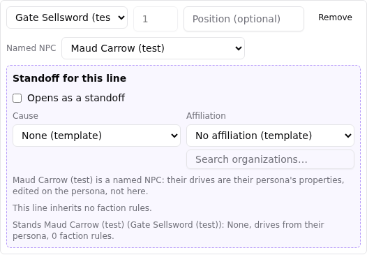 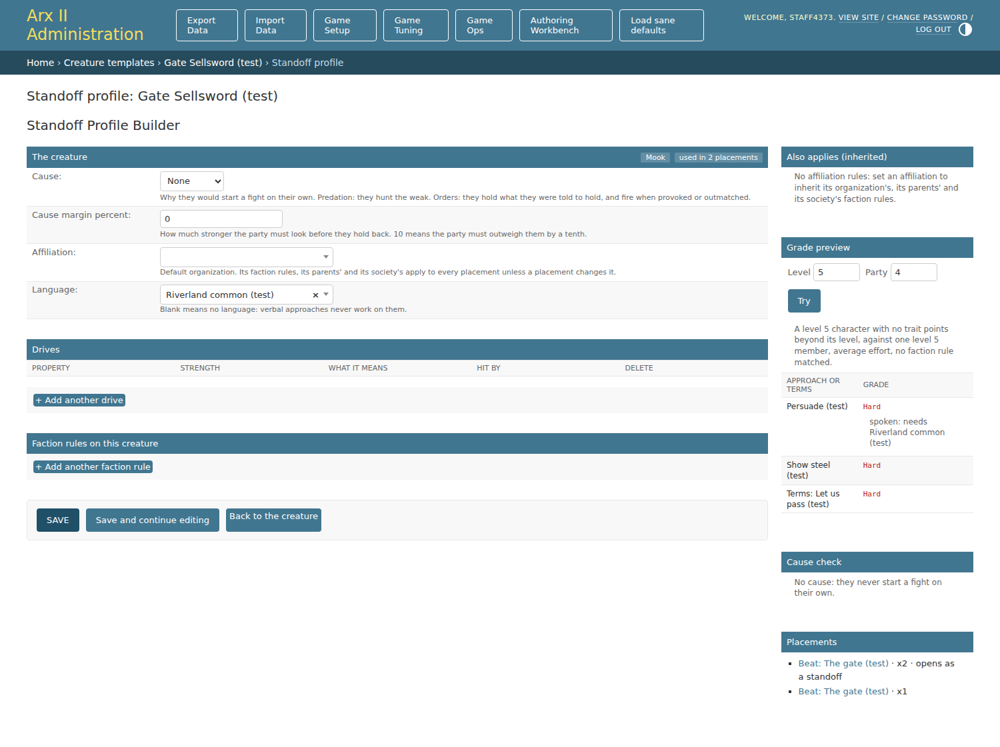 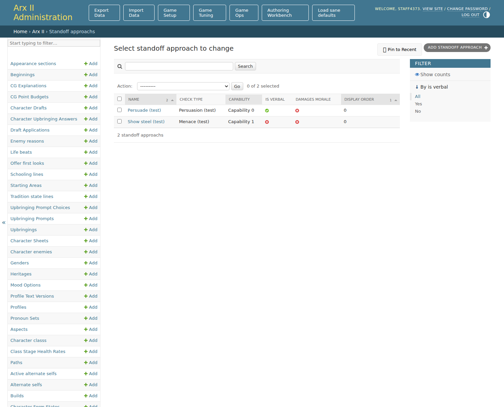 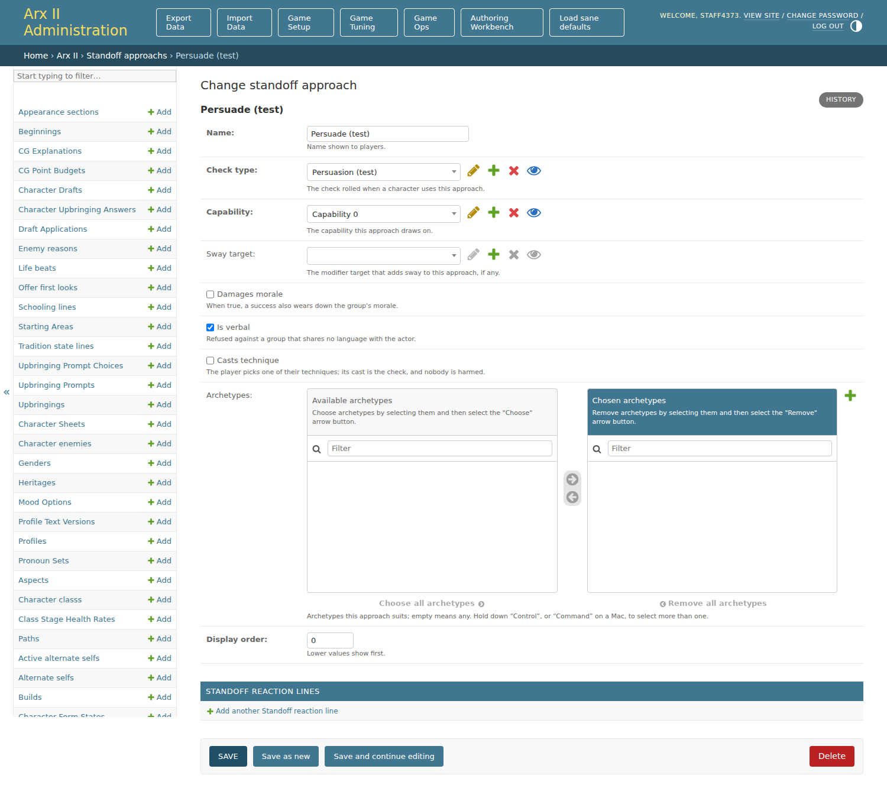 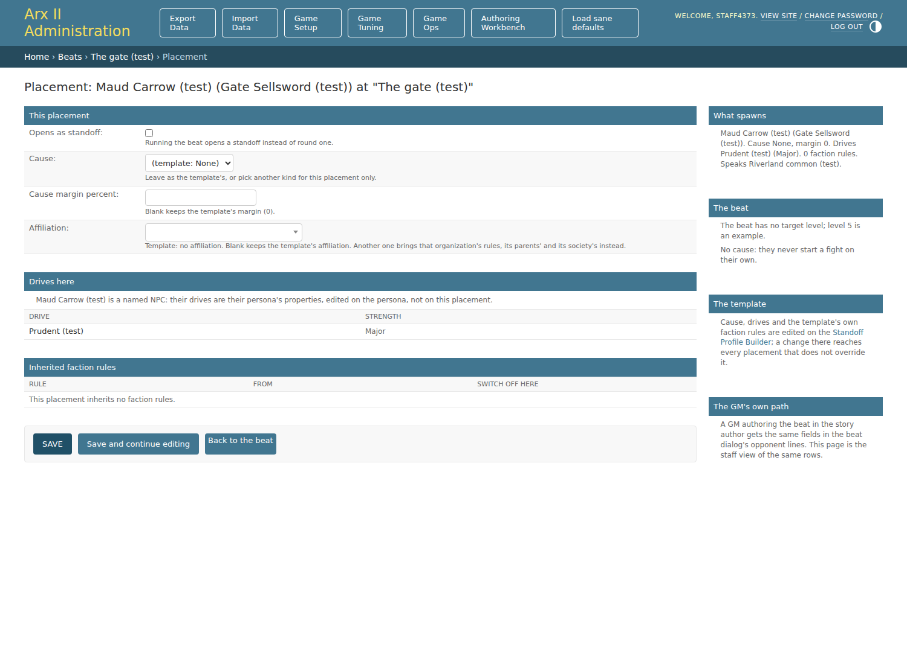 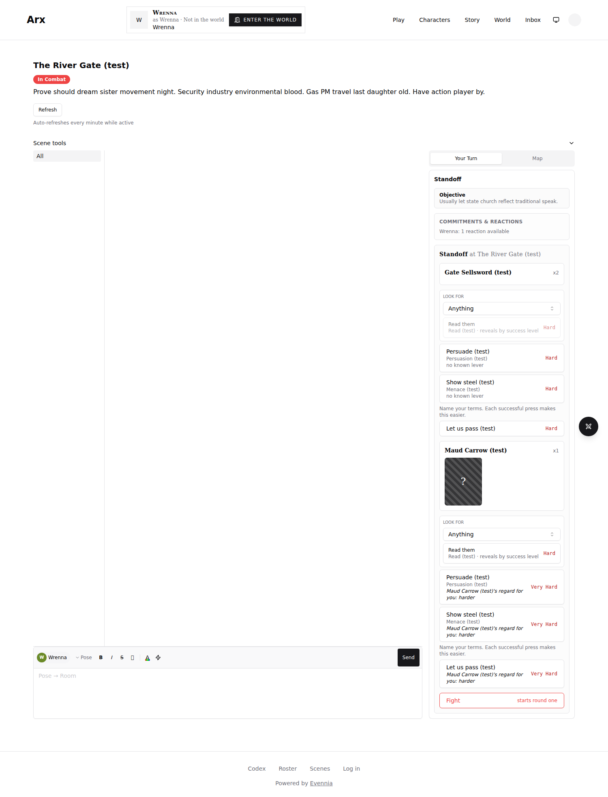 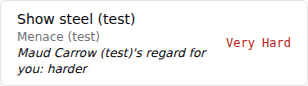 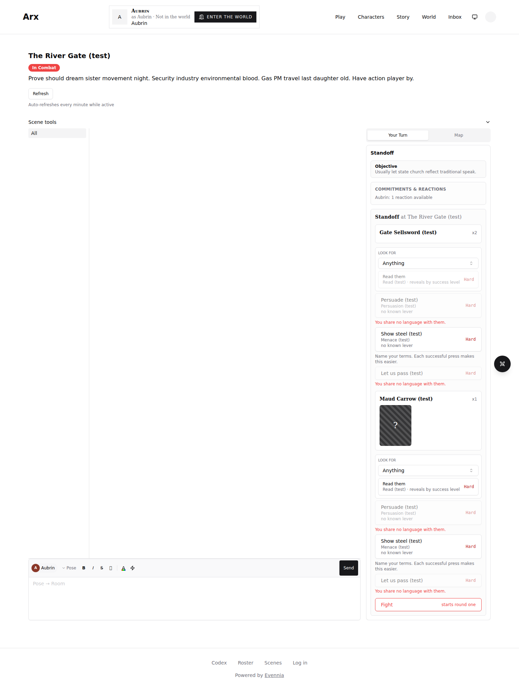  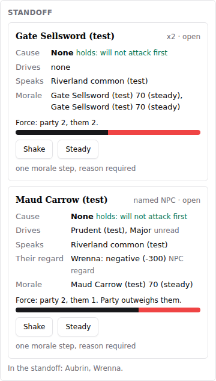 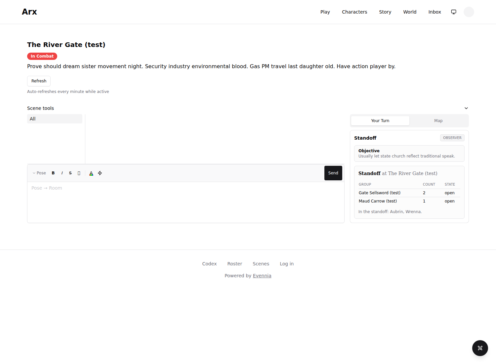 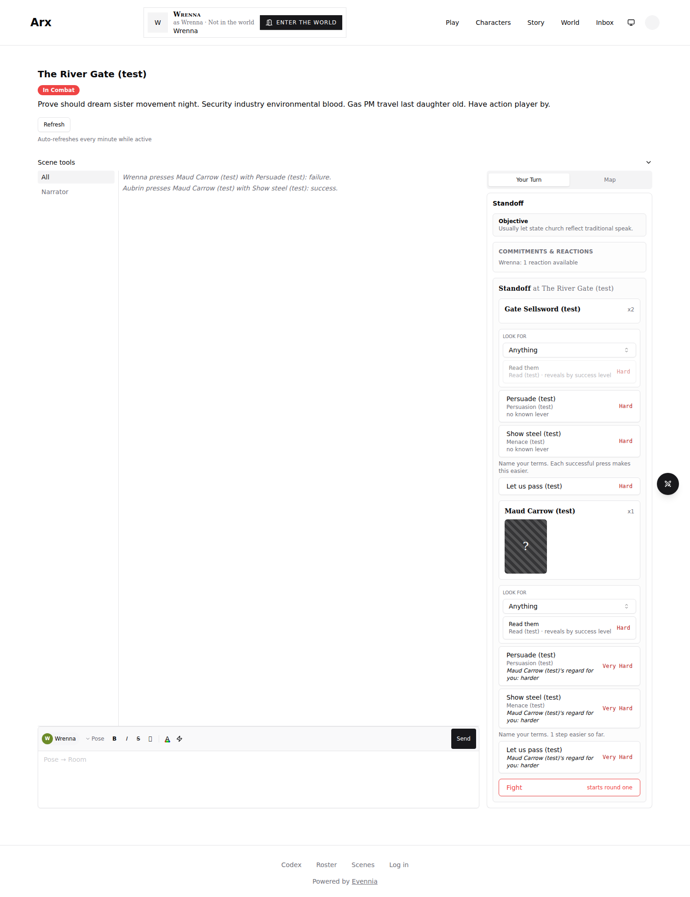 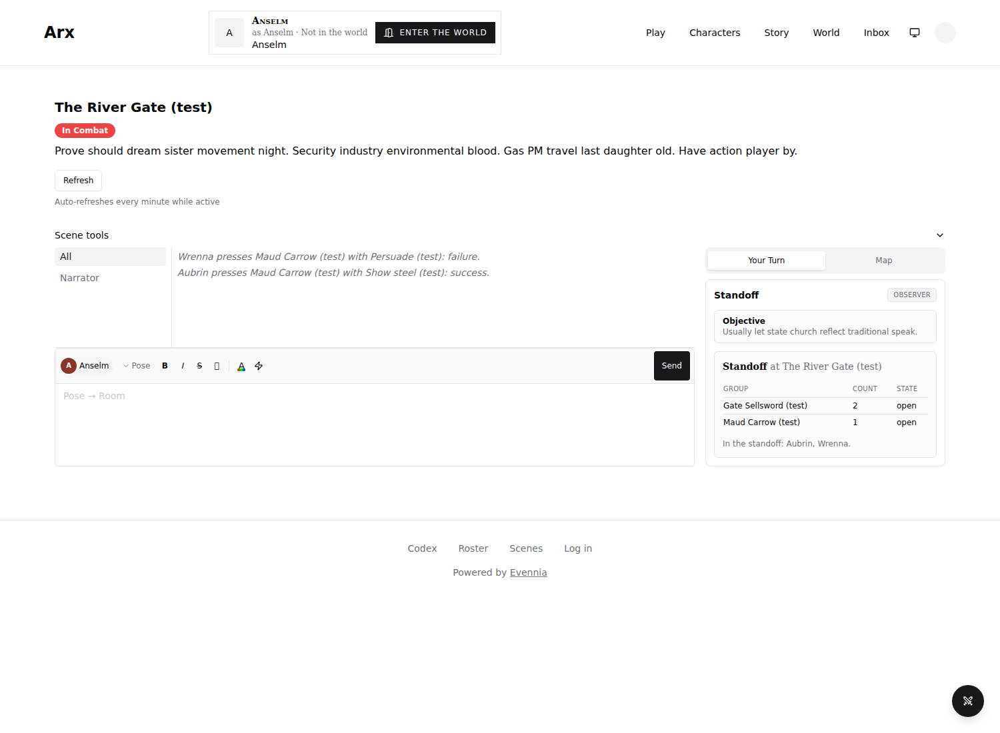
- Comparison notes: The in-scope demo parts (the named NPC group on the GM panel, player card and onlooker summary; the regard named in the grade breakdown; the language gate on the card and telnet; Admin A Language field; Admin D Is verbal; the Placement rail "Speaks"; the beat line naming a named NPC) were compared with the build. The first pass returned FAIL on evidence and five findings: every grade read Impossible so the regard's effect was not shown (fixed: check resolution tables seeded, the same non-verbal approach now grades Very Hard for the disliked player and Hard for the other); the GM row label and neutral entries (now "Their regard", non-neutral participants only); group order (template groups first, as the demo); the approach change form was not captured (03b added, help text now the demo's); "Your words" on a non-verbal press (fixed). Stated divergences accepted by the reviewer: example values differ from the demo's; the GM row reads "Their regard" (persona gender is not modelled) and shows the value to the GM only; the beat dialog's Named NPC picker is spec item 10 though the demo does not draw it. Later-slice items (Hunger, Hatred, Territory, cause_effect, the broken hold, PC profiles, the approach Reaches and terms panels, the config preview) are out of scope.
- Tested interactions: signed in through the real login form as the GM, two players, an onlooker and staff; the GM added a line in the story author's beat dialog, picked the named NPC, saved, reloaded and read it back; staff opened the Standoff Profile Builder, the approach list and change form, and the Placement page of the named line; after the beat ran, each seat loaded the scene page; the speaking player pressed the named NPC with the verbal approach from the card; the non-speaking player was refused on telnet for the verbal approach and terms and rolled the non-verbal one; the GM and onlooker read `standoff` on telnet
- Fixture/live boundary: everything reached the live backend; the scripted steps were the seed (accounts, characters, language and fluency, the named NPC with a property, language and regard, the template, approaches, terms, story with a protected subject, beat and line) and running the beat's encounter through RunBeatAction's own _run_encounter_beat in a shell between the browser phases, which also removed the onlooker from the encounter with the GM's remove-PC service
- Overall outcome: PASS

## Visual checklist

| Element | Expected | Result | Evidence |
|---|---|---|---|
| GM panel named NPC group | Header with "named NPC", Cause, Drives from the persona, Speaks, regard row, Morale, Shake and Steady | MATCH |  |
| GM panel Speaks on a template group | The template's language | MATCH |  |
| Player card named NPC | Face-down card named by the NPC, x1, listed after the company | MATCH |  |
| Regard in the grade breakdown | Regard eases or hardens the grade and is named on it | MATCH |   |
| Language gate | Verbal approaches and terms shown with the reason and refused; Read and non-verbal approaches stay | MATCH |  |
| Onlooker summary and room line | Groups, counts, state; the press line names the NPC; nothing private | MATCH |   |
| Standoff Profile Builder | Language field with the demo's help text; preview marks spoken approaches | MATCH |  |
| Approach admin | Is verbal checkbox with the demo's help text; list column and filter | MATCH |  |
| Placement page | Named NPC drives read-only from the persona; rail "Speaks" | MATCH |  |
| Beat dialog | A line names the named NPC; count locked; drives from the persona | MATCH |  |

## Requirement ledger

| ID | Status | Evidence | Authorized decision |
|---|---|---|---|
| S3-named-npc-group | PASS | 05, 07, 08 screenshots; world/standoffs/tests/test_named_npcs.py NamedGroupTests; actions/tests/test_gm_story_run_beat.py named NPC line | |
| S3-persona-drives | PASS | 04, 07 screenshots; test_named_npcs.py drives and nothing stamped on the NPC's character | ADR-4373-A |
| S3-standing-a-named-npc | PASS | 01c screenshot; test_named_npc_authoring.py; actions/tests/test_gm_combat_actions.py AddNamedNPCOpponentTests; commands/tests/test_encounter_command.py addnamed | |
| S3-npc-regard | PASS | 05b and 06b screenshots; test_named_npcs.py RegardTests | |
| S3-language-gate | PASS | 06 screenshot and telnet transcript; test_named_npcs.py LanguageGateTests; commands/tests/test_standoff_command.py | |
| S3-admin | PASS | 02, 03, 03b, 04 screenshots; web.admin standoff tests | |
| S3-migrations | PASS | newest production dump restored to a scratch database, migrated forward, back to 0234 and forward again; old-shape rows carried across (PR Verification) | |

## Unresolved findings

- None
