# Review evidence

- Reviewed revision: 6c756fa8b6a77f758929b9bf58bdf4edecc09296
- Reviewer: demo-fidelity-reviewer (vision-capable agent), comparing the rendered branch against the approved demo
- Reviewer verdict: PASS
- Application/build identity: Arx II branch feature-4416-favor-with-beings-slice-4-stewards-answe at the revision above; production frontend bundle built from this branch, served by the branch's own server at http://localhost:4001
- Environment: throwaway Postgres database rt_4416; accounts staff_4416 (staff) and gm_4416 (Senior table GM of table 1, "The Whitlow table", being Wisket id 1); Chromium driven by Playwright against the live server; telnet sessions for the answering path
- Viewports/themes: 1280 px wide desktop, light theme, for every screen; 430 px wide phone for the Beings tab (13-beings-tab-phone.png); the admin follows the browser's automatic theme (light)
- Approved design: issue #4333 demo, revision 11, https://claude.ai/artifact/WnBj714NF8MQiPQVBb1ifG, saved copy read in full; screens compared are the "Table GM and scene GM" tab Screen 1, Screen 2, Screen 3, Admin 6, and the worship module of Admin 2. Screen 4 is slice 5 and out of scope.
- Visual review: completed. Each demo screen was compared with the rendered branch at the same viewport and theme, reading the demo text and the demo's own CSS and every screenshot below with vision.
- Visual verdict: PASS
- Screenshots: 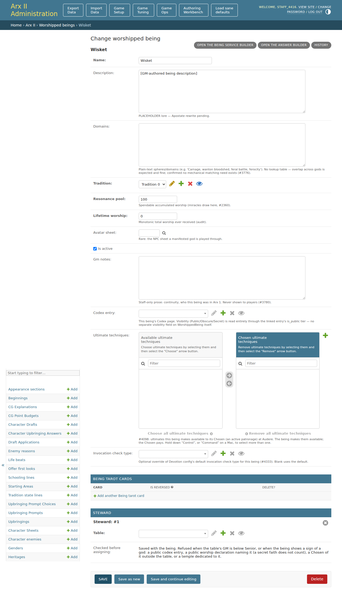 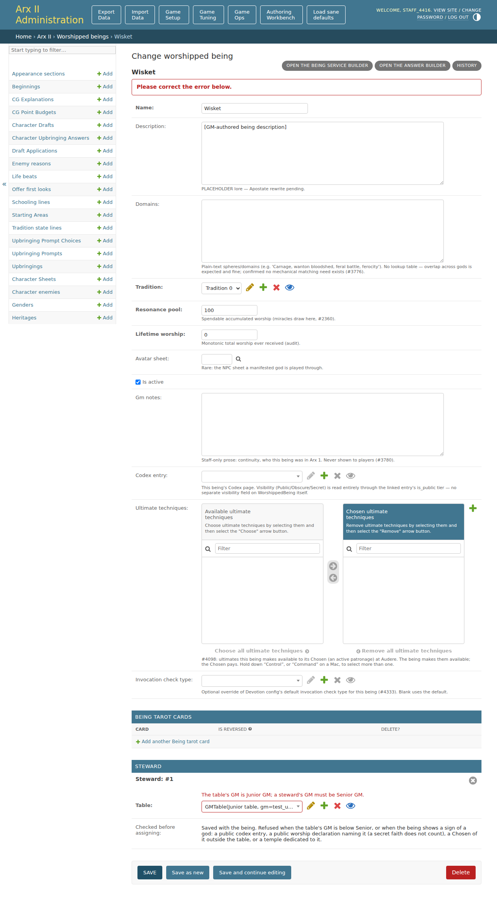 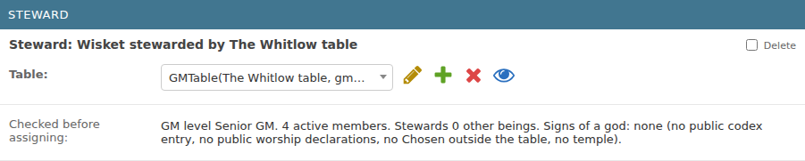 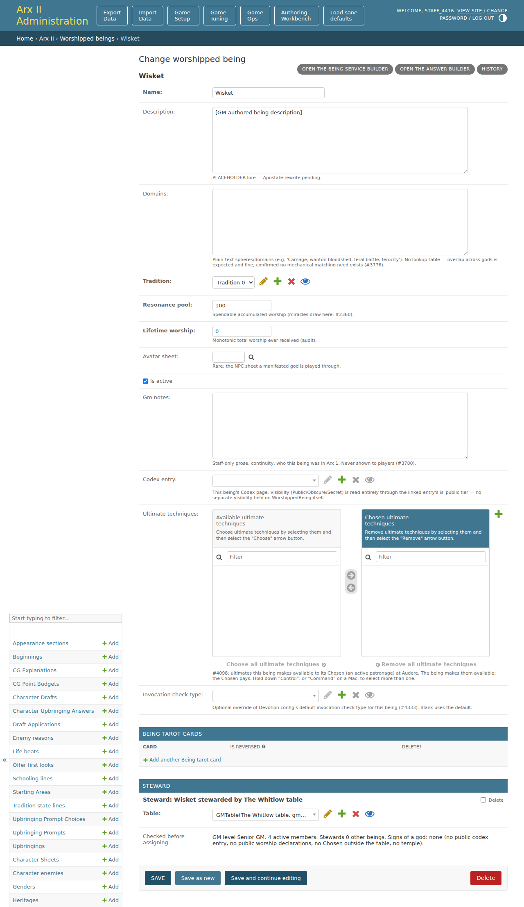 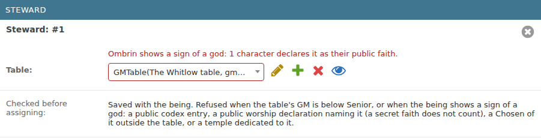 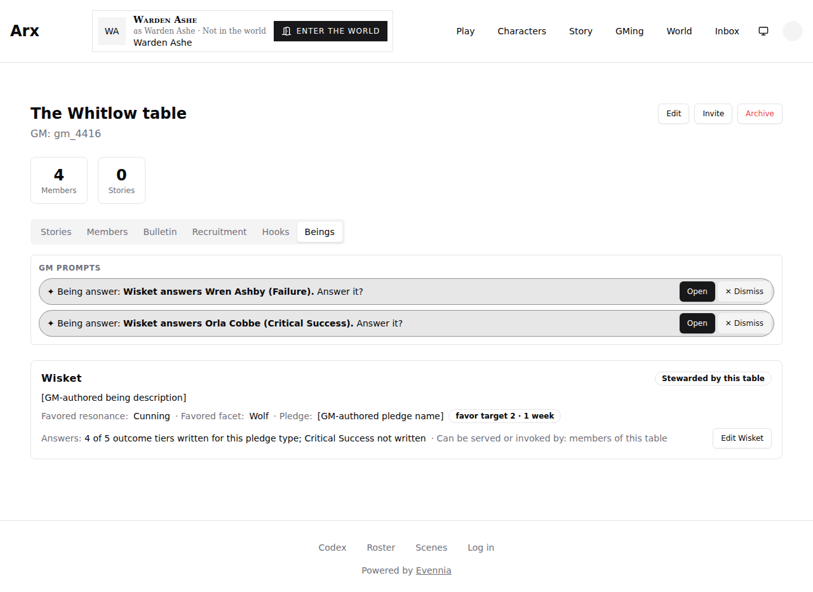 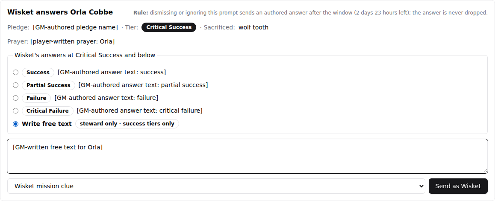 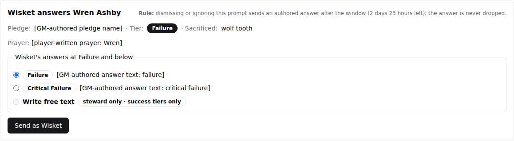 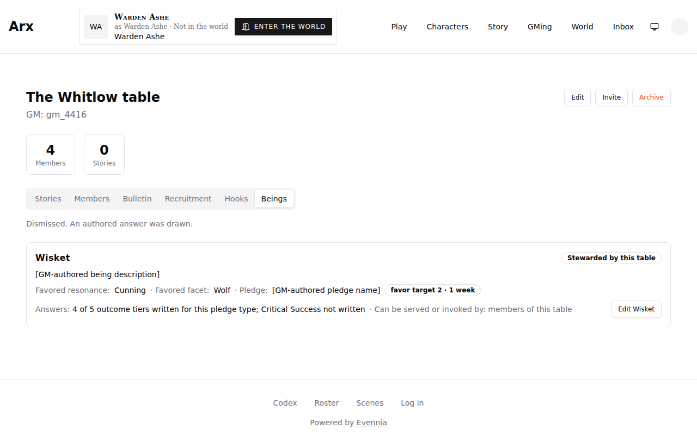 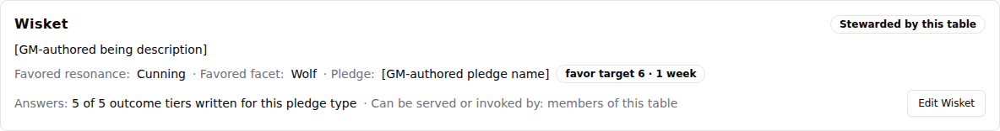 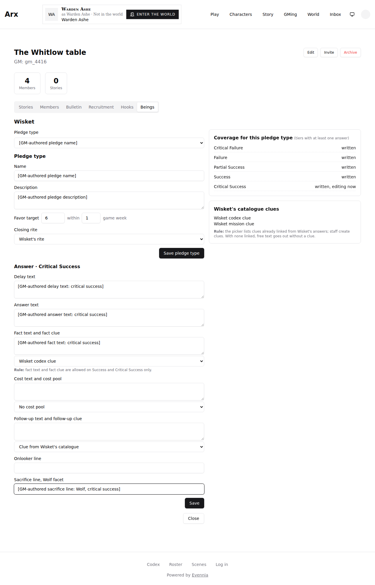 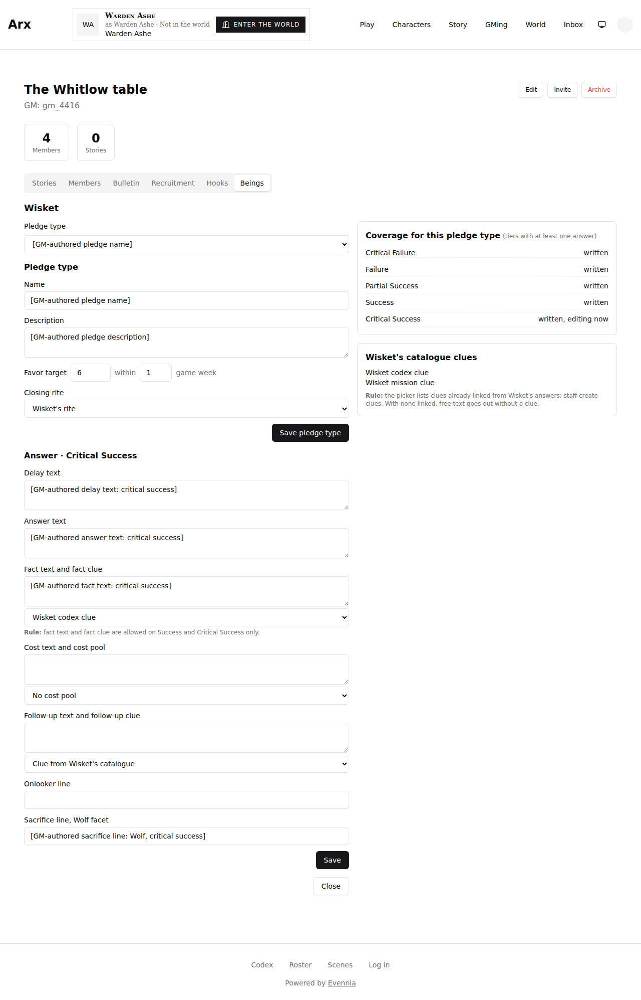 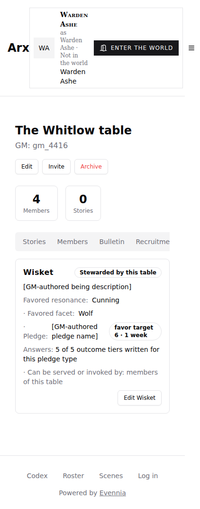 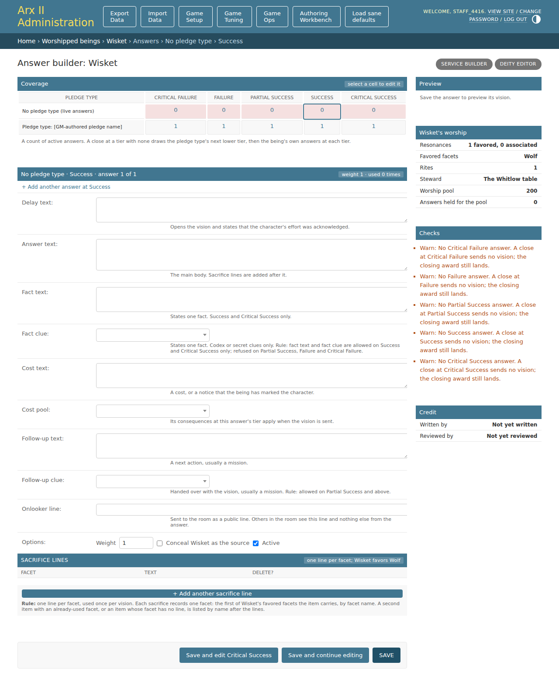
- Comparison notes: Layout, regions, copy and behaviour match the demo on every in-scope screen. Five differences were evaluated and are accepted, each with a reason a maintainer can overrule. (1) The admin table picker shows the GMTable default str "GMTable(The Whitlow table, gm=gm_4416)" (truncated in the closed picker) where the demo shows "The Whitlow table"; the saved inline title does read "Wisket stewarded by The Whitlow table". Staff-only cosmetic; a one-line label on the picker would close it and is recommended, not required. (2) The inline shows a read-only "Checked before assigning" row (the live context line plus the rule text) instead of the demo's separate context line and help paragraph; the same copy is present in one row, and the context line appears once saved. (3) The editor adds a "Pledge type" picker (existing types plus New pledge type) above the form, which the demo does not draw; it is how a GM with several pledge types reaches one, the demo shows a single pledge. (4) The pill renders grey: the demo styles it with color-mix of --primary at 10 percent, and this app's theme --primary is near black, so the same rule yields grey; the rule is the demo's, the token is the app's. (5) The clue picker in the answer panel appears only when Write free text is selected, which is where the demo draws it; its demo caption "Attach a clue from Wisket's catalogue:" is the control's accessible name, not visible text. Example values in the demo (favor target 10, 4 of 5 tiers, Success tier, 2 days 21 hours) differ from the live data by design (the demo says every number is an example). The 09 image duplicates 12 and is not cited; the "before" card is the one in 08.
- Tested interactions: staff assigned the steward in the Wisket change form (Junior table refused, Whitlow table saved, a god sign refused on Ombrin); members-only refusal, sacrifice and close through telnet; the GM saw the BEING_ANSWER pills on the Beings tab, opened the panel, wrote free text with a catalogue clue on Critical Success, sent it, and dismissed another prompt; the panel below Success disabled free text; the timeout tick returned 1 and drew an authored answer; the table GM edited the pledge type (favor target 6) and wrote the Critical Success answer, after which the card read 5 of 5; the phone width was loaded; staff linked a contributor in the throwaway database through the Authoring Workbench and opened the Answer builder rail. Transcripts: a-*.txt, b-*.txt, c-card-after.txt, telnet-session1..3.txt, db-state.txt, timeout-tick.txt.
- Fixture/live boundary: live code paths against a throwaway database seeded with labelled placeholder content (seed.py.txt). The only stand-in is time: the timeout test moved one prompt's creation time back by 3 days and a minute in a shell, then ran the real tick. The prodcopy-migration*.txt files cover the migration on a production-shaped copy. No production data was touched.
- Overall outcome: PASS

## Requirement ledger

| ID | Status | Evidence | Authorized decision |
| --- | --- | --- | --- |
| screen1-table-beings | PASS | 05-beings-tab-waiting.png, 12-being-card-after.png: Beings tab, Wisket card with Stewarded chip, description, resonance, facet, pledge chip, answers coverage line, Edit Wisket | none needed |
| screen2-edit-wisket | PASS | 10-editor-critical-success.png, 11-editor-after-save.png: pledge type and answer forms, coverage card, catalogue clues card with the rule text | Pledge type picker above the form is an accepted addition (comparison note 3) |
| screen3-prompt-pill-and-panel | PASS | 05, 06, 07, 08: pill with Open and Dismiss, panel with rule line, pledge, tier, sacrificed, prayer, answers at or below tier, free text, clue picker, Send as Wisket | Grey pill is the demo's rule on the app's theme token (note 4); clue caption is an accessible name (note 5) |
| admin6-steward-inline | PASS | 01 to 04, 03b: stock inline in a Steward module, table picker, context line, refusals for Junior GM and god sign | Picker label and merged context row are accepted differences (notes 1 and 2); recommend labelling the picker |
| admin2-rail-steward-stat | PASS | 14-answer-builder-steward-stat.png: "Steward: The Whitlow table" in Wisket's worship module, between Rites and Worship pool; the unstewarded wording is checked by test_the_rail_names_the_steward, not rendered | none needed |
| copy-approved-text | PASS | Rule lines, tier pills, "steward only · success tiers only", "not written" wording and prompt text in 05 to 08 and 10 | none needed |
| phone-width | PASS | 13-beings-tab-phone.png: tabs scroll, card stacks; the pledge label wraps unevenly beside its chip, cosmetic | Not in the demo, which draws desktop only |
| screen4-live-rite | OUT_OF_SCOPE | not built in this slice | Slice 5 per the dispatch for #4416: a rite in a running scene, may_adapt_answers, miracles |

## Visual checklist

| Element | Expected | Result | Evidence |
| --- | --- | --- | --- |
| Table page tab strip | Stories, Members, Bulletin, Recruitment, Hooks, Beings tabs with Beings selected | MATCH | 05-beings-tab-waiting.png |
| Screen 1 being card header | Wisket with a "Stewarded by this table" chip | MATCH | 05-beings-tab-waiting.png |
| Screen 1 description | GM-authored description slot under the name | MATCH | 05-beings-tab-waiting.png |
| Screen 1 favored line | Favored resonance and favored facet | MATCH | 05-beings-tab-waiting.png |
| Screen 1 pledge line | Pledge name and a chip reading favor target and weeks | MATCH | 12-being-card-after.png |
| Screen 1 answers line | N of 5 outcome tiers written, naming a missing tier | MATCH | 08-after-dismiss.png, 12-being-card-after.png |
| Screen 1 access line | Can be served or invoked by: members of this table | MATCH | 05-beings-tab-waiting.png |
| Screen 1 Edit button | Edit Wisket at the right of the card | MATCH | 05-beings-tab-waiting.png |
| Screen 2 pledge form | Name, Description, Favor target within N game week, Closing rite picker | MATCH | 10-editor-critical-success.png |
| Screen 2 answer form | Delay text, Answer text, Fact text and clue, Rule line, Cost text and pool, Follow-up text and clue, Onlooker line, Sacrifice line for the Wolf facet | MATCH | 10-editor-critical-success.png |
| Screen 2 buttons | Save and Close | MATCH | 10-editor-critical-success.png |
| Screen 2 coverage card | Per-tier written or not written, the tier being edited marked "editing now" | MATCH | 10-editor-critical-success.png |
| Screen 2 catalogue clues card | Clue names plus the picker rule line | MATCH | 10-editor-critical-success.png |
| Screen 3 pill | Star mark, "Being answer: Wisket answers X (tier). Answer it?", Open and Dismiss | MATCH | 05-beings-tab-waiting.png |
| Screen 3 panel heading and rule | "Wisket answers X" with the window rule line and time left | MATCH | 06-answer-panel-free-text.png |
| Screen 3 context line | Pledge, tier chip, sacrificed item, prayer | MATCH | 06-answer-panel-free-text.png |
| Screen 3 answer list | Wisket's answers at the tier and below, radio per answer, never a higher tier | MATCH | 06-answer-panel-free-text.png, 07-answer-panel-below-success.png |
| Screen 3 free text | Write free text with "steward only · success tiers only", disabled below Success | MATCH | 06-answer-panel-free-text.png, 07-answer-panel-below-success.png |
| Screen 3 clue picker and send | Clue picker, then Send as Wisket | MATCH | 06-answer-panel-free-text.png |
| Admin 6 change form | Stock worshipped being form with the Steward inline module | MATCH | 03b-being-change-form.png |
| Admin 6 steward row | Table picker and context line (level, members, other stewards, signs of a god) | MATCH | 03-steward-saved.png |
| Admin 6 rule text | Refusal rule for a Junior GM and for a god, stated on the page | MATCH | 01-steward-inline-empty.png |
| Admin 6 refusals | Errors name the Junior GM and the public faith | MATCH | 02-steward-refused-junior.png, 04-steward-refused-god-sign.png |
| Admin 2 worship module Steward stat | A Steward row among Resonances, Favored facets, Rites | MATCH | 14-answer-builder-steward-stat.png |

## Unresolved findings

None
